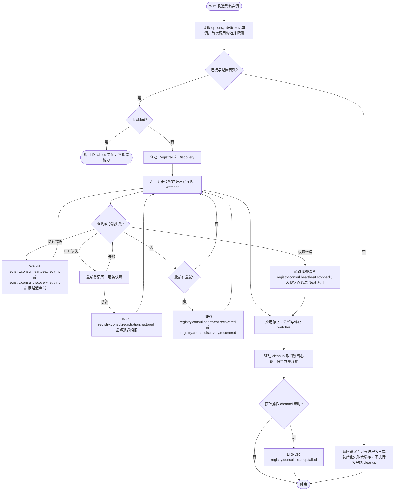

# Consul 注册与发现驱动

业务空导入本包后，`init` 向 `pkg/registry` 登记 `consul` 工厂。使用 `registry.instances.<name>.driver: consul` 创建具名实例，同时提供 Registrar 与 Discovery；只导入而未声明实例不会连接 Consul。

本包不提供单独构造注册/发现适配器的公共函数，也没有旧 Discovery 包的转发入口。配置与示例见[具名驱动](../../../pkg/registry/README.md)。`options.registry` 控制健康检查、心跳和标签，`options.discovery` 控制查询超时与数据中心；连接仅由启动 env 决定，`options.connection` 已删除并在使用时返回错误。

Consul 禁用时，工厂保存 Disabled 实例，Registrar/Discovery 解析返回 nil、nil；App 不注册。要求发现目标的客户端仍会因发现能力不可用而返回错误。

省略选项时的默认行为：

| 选项 | 默认值 |
| --- | --- |
| registry.disable_health_check / disable_heartbeat | false |
| registry.disable_grpc_health_check | false：gRPC 端点使用 gRPC 健康检查；true 时退回 TCP 检查 |
| registry.failures_before_critical | 2，端点检查连续失败该次数后才判定为 critical，必须至少为 1 |
| registry.healthcheck_internal | 5s，必须为至少一秒的整秒；端点检查与心跳共用，TTL 为其两倍 |
| registry.deregister_critical_service_after | 600s，必须为至少一秒的整秒 |
| registry.tags | 空列表；拒绝空白、首尾空格与重复标签 |
| discovery.timeout | 10s，必须为正数 |
| discovery.dc | SINGLE；另支持 MULTI |

## 健康检查

每个注册实例登记以下 Consul 检查，服务发现只返回全部检查通过的实例：

| 检查 | 作用 | 持续 critical 时自动注销 |
| --- | --- | --- |
| gRPC 健康检查（`grpc://` 端点） | Consul 按 `healthcheck_internal` 调用实例的 `grpc.health.v1.Health/Check`（空服务名）。Foundation 默认健康服务与 `/readyz` 一致：应用未就绪、停机中或 readiness 依赖检查失败时返回 `NOT_SERVING`，实例变为 critical 并从发现结果中移除，恢复后重新出现 | 否（启用心跳时）；关闭心跳时是 |
| TCP 检查（`http://` 等其他端点，及 `disable_grpc_health_check: true` 时的 gRPC 端点） | 端口可连接 | 是 |
| TTL 心跳 | 进程定时续报，未按时续报（进程退出或卡死）时 critical；TTL 缺失时重新登记 | 是 |

- **就绪即接流量**：实例在 Consul 中可见与否跟随应用就绪状态，readiness 依赖检查失败等于该实例不再接收任何经服务发现的流量。只把“缺少它整个服务都不可用”的依赖放进 readiness 检查。
- **未就绪不注销**：依赖长时间故障时实例保持登记、只是不可见，恢复后在下一次检查通过时立即重新可见，不需要重启或重新发布。进程退出或卡死仍由心跳与 TCP 检查按 `deregister_critical_service_after` 自动注销。关闭心跳时没有其他检查兜底，gRPC 健康检查也参与自动注销，注销后不会自动重新登记。
- **防抖与时延**：端点检查连续失败 `failures_before_critical` 次才判定 critical；默认约 10 秒（5s × 2）摘除不可用实例。新登记的检查初始为 critical，首次检查通过（约一个间隔）后才可被发现。TTL 心跳不受 `failures_before_critical` 影响。
- **前提**：Consul agent 需要能访问注册的 gRPC 端点（与 TCP 检查相同的网络要求）；gRPC 健康服务由业务通过 `server.grpc.custom_health` 或自行注册接管时，Consul 结果取决于业务实现。

SDK 客户端归进程单例所有，配置源与具名实例共同借用。App 停止注册、客户端停止发现监听后，Wire 逆序执行 cleanup；驱动取消残留心跳，保留共享连接。发现 watcher 的 Stop 会取消挂起查询；超时及临时错误按已有退避重试，权限错误停止监听。注册 heartbeat 在 Deregister 时停止，缺失 TTL 检查时重新登记快照。

并发与同步边界见[Factory 生命周期](../../../pkg/registry/README.md#生命周期与并发)。注册操作仍通过实例内可取消的 operations channel 串行化；发现 watcher 各自拥有取消函数、完成通知与幂等 Stop，不共享阻塞索引。

在仓库根执行 `go test -race ./contrib/registry/consul`，使用本机测试 HTTP 服务验证注册、查询、监听取消、重连与资源释放，无需真实 Consul。`make test-external` 另在隔离 Docker Consul 中验证 gRPC 健康检查：未就绪实例变为 critical 并被发现过滤、不被注销，恢复后重新可见。

心跳事件位于 `module=registry`，发现事件位于 `module=discovery`；具名 Factory 注入的 `instance` 字段继续保留，`driver=consul` 标识适配器。重试事件包含 `error`、从 1 开始的 `attempt`，恢复事件包含 `attempts`；心跳包含 `service.id`，发现包含 `service`。TTL 缺失后重登记成功使用 INFO `registry.consul.registration.restored`，只表示登记快照重建，TTL 续报恢复仍单独记录 `registry.consul.heartbeat.recovered`。心跳永久故障无人同步接收，记录一次 ERROR `registry.consul.heartbeat.stopped`；发现永久错误通过 `Next` 返回，不额外重复 ERROR。无返回值 cleanup 获取操作 channel 失败时记录 ERROR `registry.consul.cleanup.failed`。发现日志绑定 Watch Context，传播其 trace；心跳属于独立后台生命周期，使用自身 Context，没有 Register 请求 trace。业务 Register、Deregister、GetService 与首次 Watch 的同步错误返回调用边界，不重复记录。
