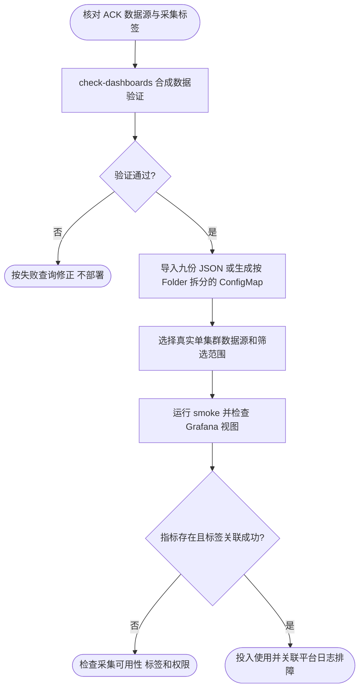

# Foundation 指标面板

一个平台总览只放症状，详情按资源类型做成模板化页面，用变量切换服务、数据库实例、Redis 实例、队列或网关，不为每个服务复制 JSON。导入下面九份 JSON 并选择 Prometheus 数据源；平台总览只读 [alerts.yaml](prometheus/alerts.yaml) 中 `foundation-records` 组的预聚合与 `ALERTS`，须同时加载该规则文件。

| Folder | 页面 | 回答的问题 | UID |
| --- | --- | --- | --- |
| 00 总览 | [平台总览](grafana/dashboards/foundation-fleet.json) | 哪些告警在触发，哪个应用、Pod/节点、数据库、Redis、消费组或网关下游有症状？ | `foundation-fleet-overview` |
| 10 服务 | [服务详情](grafana/dashboards/foundation-service.json) | 这个服务的 HTTP/gRPC RED、消费者、Job、Runtime 哪里不好？ | `ack-service-overview` |
| 10 服务 | [网关详情](grafana/dashboards/foundation-gateway.json) | 哪个路由在报错或被限流，哪个下游拖垮了网关？ | `foundation-gateway` |
| 10 服务 | [应用组件](grafana/dashboards/foundation-components.json) | 是哪个端点、Cache、Job、Lock、OSS 或 Go 进程的问题？ | `ack-application-components` |
| 20 中间件 | [数据库详情](grafana/dashboards/foundation-database.json) | MySQL 是否饱和、慢查询或复制落后，是哪个应用占满连接？ | `foundation-database` |
| 20 中间件 | [Redis 详情](grafana/dashboards/foundation-redis.json) | Redis 内存、逐出、延迟、连接是否异常，是哪个应用在等待连接池？ | `foundation-redis` |
| 20 中间件 | [队列与 Kafka 详情](grafana/dashboards/foundation-messaging.json) | 哪个队列/消费组在积压，哪个消费者在重试或进死信？ | `foundation-messaging` |
| 30 基础设施 | [容器与节点](grafana/dashboards/foundation.json) | Pod、部署副本或机器资源是否异常？ | `ack-container-overview` |
| 30 基础设施 | [健康探测](grafana/dashboards/foundation-shared.json) | 实际 `/readyz`、`/healthz` HTTP 探测是否成功？ | `foundation-shared-resources` |

业务自定义指标页放 90 业务 Folder，由业务自行维护，不进本模板。Folder 与文件的对应关系见 [folders.json](grafana/folders.json)。

## 页面规划

从平台总览定位异常分区，表格中的应用、实例、消费组、队列链接到对应详情页；所有页面顶部导航相同，跳转保留时间和同名变量。服务详情按负载类型分区，除 HTTP/gRPC RED 外默认折叠（Grafana 不能按是否有数据自动折叠，首行“负载识别”卡片标明哪些分区有数据）。数据库与 Redis 详情并列 exporter 服务端指标和各应用客户端连接池/耗时，按应用拆分；原组件页的 Database、Redis、Queue、Kafka 区块整体迁到对应中间件详情页，查询与面板 ID 不变，组件页只保留进程内组件。

服务详情、应用组件、容器与节点及中间件详情中的应用区块支持 Pod、Node、Instance（Pod IP）、Container 四种视图；应用指标按命名空间和应用隔离。exporter 服务端区块按 exporter 的 `instance`（变量 `db_instance`、`redis_instance`）选择，Queue 库存与 Kafka Lag 使用 env/cluster、逻辑队列、Kafka 集群/消费组/真实 Topic 筛选，均不套用 Pod/Node 视图。exporter 未接入时对应区块显示“未接入”，不当作健康。完整口径见 [面板说明](docs/dashboard.md)，页面清单、每页回答的问题与所需 exporter 见 [多项目监控与告警规划](docs/fleet-monitoring.md)。

## ACK 接入

一个数据源对应一个集群，需具备 kube-state-metrics、kubelet/cAdvisor、node-exporter。默认 ACK 集成不保证所有可选指标启用；先看“采集可用性”区块，再检查缺失组件。核心指标有样本也不代表所有目标健康。

应用指标另外需要 namespace/app/container 和 pod_name 采集标签；若采集使用 pod，在可见的“应用 Pod 标签”选择 pod。All 可展示尚未附加 app 的旧指标，具体应用筛选需要真实 app 标签。基础设施区不依赖应用 target_info 或 foundation 标签。node-exporter 的 node 或 nodename 需与 Kubernetes 节点名匹配；虚拟节点可能没有整机指标。

导入九份 JSON 并选择真实数据源；mysqld_exporter、redis_exporter、kafka-exporter、blackbox 均为可选，未部署时对应区块显示“未接入”。应用入口示例：

```text
/d/ack-service-overview?var-namespace=orders&var-app=orders-api&var-view=view_pod&var-app_pod_label=pod
```

数据源权限负责访问隔离；筛选项不是租户权限控制。文件 provisioning 应更新源 JSON 后同步，避免界面编辑被覆盖。

## 验证与打包

先确保 Docker 可用；以下命令均从仓库根目录执行：

```sh
# 导航、Folder、变量、空样本语法及各页合成样本（含 exporter 未接入）验证，不访问实际监控数据。
make -C deploy/observability check-dashboards

# 如已有包含 promtool 的本地容器，可复用，避免额外启动镜像。
make -C deploy/observability check-dashboards PROMTOOL_CONTAINER=foundation-observability-prometheus-1

# 仅生成 ConfigMap 和示例规则包装，不连接集群。
make -C deploy/observability render-kubernetes
```

打包产物位于 `/tmp/foundation-monitoring/dashboard.json` 和 `rules.yaml`；`dashboard.json` 是按 Folder 拆分的四个 ConfigMap（`grafana_folder` 注解为 00 总览 / 10 服务 / 20 中间件 / 30 基础设施），共九份面板。JSON 是面板源文件，不手改打包产物。`rules.yaml` 包含原有示例应用告警与平台总览依赖的 `foundation-records` 预聚合，不是面板的完整告警策略；部署前须按实际平台调整，不应因导入面板就直接启用告警。

真实联调需使用能直接访问 Prometheus HTTP API 的地址，可选传入能读取面板 API 的 Grafana 地址；认证按平台正常流程处理，不在仓库写入凭据：

```sh
make -C deploy/observability smoke \
  PROMETHEUS_URL=http://127.0.0.1:19090 \
  GRAFANA_URL=http://127.0.0.1:13000 \
  APP_POD_LABEL=pod \
  COMPONENTS=server,sql,redis,queue,go
```

此处地址仅示意已有的本地端口转发；必须指向具备 ACK 指标的服务。`COMPONENTS` 只填写已启用的组件，可选值为 server/client/sql/redis/cache/queue/kafka/job/lock/oss/go/queue-stats/kafka-lag/probe/gateway/mysql-exporter/redis-exporter，逗号分隔。指定后要求代表指标及面板关联有有效非空结果；Queue/Kafka 支持仅 Producer 或仅 Consumer。未指定的组件明确报告“未验证”，不能把空图当接入成功。`APP_POD_LABEL` 默认 pod_name，可选 pod。smoke 还检查核心指标、四种视图查询和可选的 Grafana JSON 导入，不代替浏览器插值及视觉验收。



## 本地应用示例的范围

现有 Compose 仍用于 Foundation HTTP、组件指标和示例告警体验，提供 Prometheus、Grafana、blackbox；它不是 ACK 集群，没有 kube-state-metrics/cAdvisor/node-exporter 的完整基础数据，不能用它验证新容器面板的数据完整性。启动、停止和配置检查入口仍为 `make -C deploy/observability up/down/check`，其工具和固定镜像见 Makefile。`check` 验证现有 Compose、Prometheus 与告警，不等于面板验证。

普通服务器的 [standalone.yaml](prometheus/standalone.yaml) 也是应用采集示例；带视图的页面面向 ACK，不伪造普通进程的 Pod 和节点身份。健康探测页与中间件详情的 exporter 区块可以在标签契约满足时单独使用；库存和外部采集配置见 [外部采集说明](docs/external-metrics.md)。Kubernetes ConfigMap 接入见 [Kubernetes 示例](../kubernetes/README.md)。

- [组件指标](docs/components.md)：启用条件与业务口径。
- [业务埋点](docs/business-metrics.md)：Counter、Histogram 与缓存指标接入。
- [外部采集](docs/external-metrics.md)：blackbox、Kafka Lag、MySQL、Redis exporter；与节点/cAdvisor 基础指标不同。
- [排障](docs/troubleshooting.md)：标签、采集、查询与组件诊断。
- [components 示例](../../examples/components/README.md)：本地真实业务流量验证，不替代 ACK 联调。
