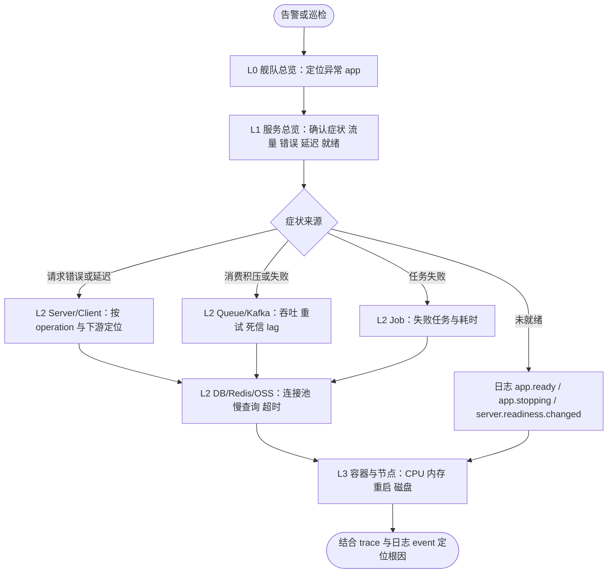
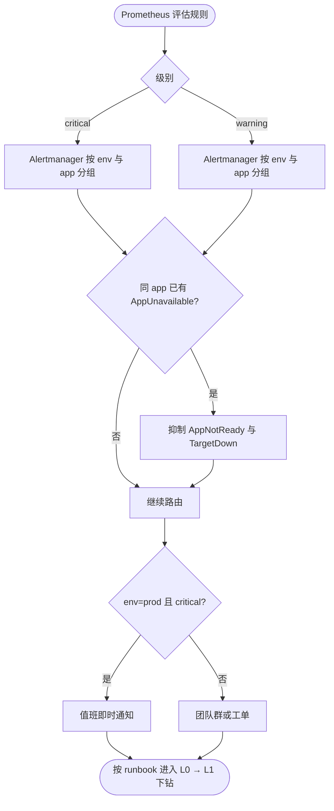

# 多项目监控与告警规划

本文规划“整套项目都基于 Foundation”时的面板分层、各类负载的观测重点与告警体系。已落地的规则见 [alerts.md](alerts.md)，面板现状见 [dashboard.md](dashboard.md)；本文中标注“规划”的部分尚未实现。

## 设计原则

1. **统一身份标签**：所有指标经采集重标为 `env`、`cluster`、`namespace`、`app`、`pod`。告警、面板与 Alertmanager 路由只按这组标签聚合，跨项目的面板才能复用同一套查询。
2. **先看症状再看原因**：顶层只放用户可感知的症状（可用性、错误、延迟、积压、任务失败），组件与资源指标放在下钻层。
3. **告警分两级**：critical 只给“服务已经不可用或 SLO 快速消耗”，需要立刻有人处理；warning 是需要当天处理的异常，进群或工单，不半夜叫人。
4. **按负载类型选信号**：HTTP、gRPC、网关、队列消费者、一次性脚本、常驻进程的“健康”含义不同，不能只用请求 RED 判断所有服务。
5. **跨负载统一的就绪信号**：`app_ready` 与 HTTP `/readyz`、gRPC 健康检查读取同一状态，是唯一对所有负载类型都成立的“应用是否可用”信号。

## 面板分层

| 层级 | 面板 | 回答的问题 | 状态 |
| --- | --- | --- | --- |
| L0 舰队总览 | [foundation-fleet.json](../grafana/dashboards/foundation-fleet.json)：每个 app 一行，列出就绪实例/总实例、RPS、5xx 比例、P95、消费速率与失败比例、最老就绪任务、近 1h Job 失败，按就绪实例升序并着色 | 现在哪些服务有问题 | 已有；近 1h 重启仍在容器与节点页 |
| L1 服务总览 | [foundation-service.json](../grafana/dashboards/foundation-service.json)：按 app 看流量、错误、延迟、就绪 | 这个服务哪里不好 | 已有，首行含 `app_ready` 就绪率；按负载类型分区待补 |
| L2 组件详情 | [foundation-components.json](../grafana/dashboards/foundation-components.json)：Server/Client/DB/Redis/Queue/Kafka/Job/Lock/OSS/Runtime | 是哪个依赖或组件引起的 | 已有 |
| L3 基础设施 | [foundation.json](../grafana/dashboards/foundation.json)、[foundation-shared.json](../grafana/dashboards/foundation-shared.json)：容器、节点、共享队列与 Kafka lag | 是不是资源或共享设施的问题 | 已有 |

L0 是多项目场景下最关键的一层。它只依赖下文的 recording rules，保证几十个 app 时依然秒开；每行的 app 名链接到 L1 并带上 `var-namespace`、`var-app`。

## 各类负载的观测重点

| 负载 | 关键指标 | 告警（已有 / 规划） |
| --- | --- | --- |
| HTTP 服务 | `server_requests_code_total`、`server_requests_seconds`、`app_ready`、DB/Redis 池 | TargetDown、AppNotReady、AppUnavailable、HighServerErrorRate、HighLatency；规划：可用性与延迟 SLO 消耗率 |
| gRPC 服务 | 同上（`kind=grpc`）；gRPC 健康检查已与 `app_ready` 联动 | 同 HTTP；K8s 使用原生 gRPC 探针 |
| API 网关 | 入口 RED + 出口 `client_requests_seconds`（按下游 target）、429 限流、熔断打开 | 同 HTTP；规划：单下游错误率/延迟（定位“哪个后端拖垮网关”）、限流比例突增 |
| 队列消费者（Queue/Kafka） | `queue_consumer_*` / `kafka_consumer_*` 吞吐与失败、重试、死信、`queue_oldest_ready_age_seconds`、Kafka lag、`app_ready` | QueueRuntimeFailure、KafkaRuntimeFailure、QueueReadyTooOld、KafkaLagHigh、AppNotReady；规划：死信速率 >0、失败率阈值 |
| 一次性脚本 | 进程退出码；K8s `kube_job_status_failed`、`kube_cronjob_status_last_successful_time`；运行足够久时有 `job_runs_total` | 规划：K8s Job 失败、CronJob 超过 N 个周期未成功（框架内指标常在被抓取前随进程退出，不能只依赖它） |
| 自定义常驻进程 | `app_ready`、容器重启、业务自定义指标 | AppNotReady、AppUnavailable、TargetDown；业务按自身语义补充 |

一次性脚本的结果以 K8s Job 状态和日志 `app.stopped result=failed` 为准：进程退出前 Prometheus 往往来不及抓取。若需要框架内指标，规划在 Job 退出前推送到 Pushgateway 或以日志告警替代。

## 告警分级与路由

| 级别 | 规则 | 通知 |
| --- | --- | --- |
| critical | FoundationAppUnavailable；规划：SLO 快速消耗（1h/5m 窗口 14.4 倍） | 电话/值班即时通知 |
| warning | FoundationAppNotReady、TargetDown、HighServerErrorRate、HighLatency、消费积压与运行时故障、Job 失败、DB/Redis 池饱和；规划：SLO 慢速消耗（6h/30m 窗口 6 倍） | 团队群或工单，工作时间处理 |

- **分组**：应用告警按 `alertname, env, cluster, namespace, app`，节点告警按 `alertname, env, cluster, node`，同一 app 的多实例合并为一条通知。
- **抑制**：同 app 的 FoundationAppUnavailable 抑制 FoundationAppNotReady 与 TargetDown；节点不可用抑制该节点上的应用告警，避免一次故障刷屏。
- **路由**：按 `env` 分流（prod 才允许 critical 呼叫），按 `namespace` 或团队标签路由到对应负责人；每条告警的 `runbook` 指向 [troubleshooting.md](troubleshooting.md) 的锚点。

## SLO 与 recording rules

每个 app 按负载类型定义一个可用性 SLO（例如 99.9%）和一个延迟 SLO（例如 P99 < 1s 的请求占比 99%）。为避免 L0 面板和告警在几十个 app 上重复计算原始直方图，已用 `foundation-records` 组预聚合 5m 速率、延迟桶、就绪实例、消费失败、Job 失败与最老就绪任务，规则清单见 [alerts.md](alerts.md#recording-rules)。比例与分位数在查询时由计数求得，不预存比值，避免跨应用再聚合时出错。

规划：为消耗率告警补 `app:server_requests:rate1h` / `rate6h` 及对应错误速率等多窗口规则。

消耗率告警采用多窗口：1h 与 5m 同时超过 14.4 倍预算消耗为 critical，6h 与 30m 同时超过 6 倍为 warning。低流量服务配合端到端探测或业务成功事件，避免少量请求导致误报。

## 落地顺序

1. 已完成：`app_ready` 指标、FoundationAppNotReady / FoundationAppUnavailable 告警及规则测试、gRPC 健康检查与就绪联动、Runtime panic 统一停机。
2. 已完成：`foundation-records` recording rules 及规则测试、L0 舰队总览面板、L1 首行 `app_ready` 就绪率；[check_dashboards.py](../check_dashboards.py) 加载同一份规则文件，用合成原始样本验证舰队页与 L1 就绪率。
3. 下一步：SLO 消耗率告警、网关单下游告警、一次性任务的 K8s Job/CronJob 告警、Alertmanager 分组/抑制配置示例。
4. 持续：panic 与配置拒绝计数指标（`app_runtime_panics_total`、`server_request_panics_total`、`config_updates_rejected_total`），让目前只有日志的异常也能告警。
