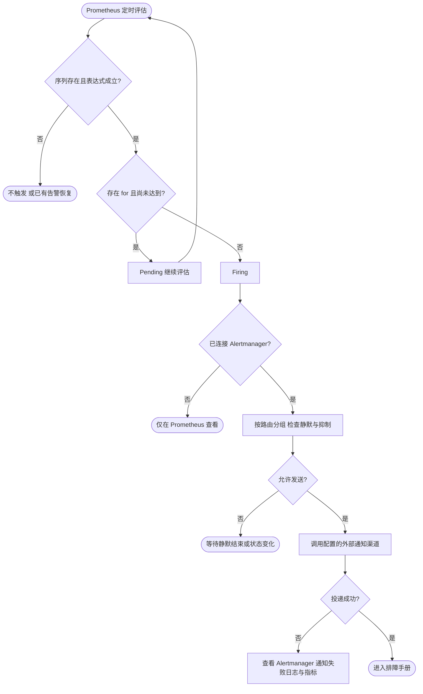
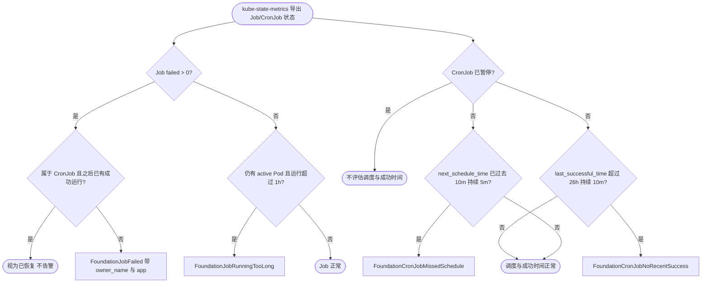

# 告警规则与通知接入

本文规则仍用于原有示例应用采集标签，不是新版 ACK 容器全视图的完整告警策略。导入新面板不代表应直接部署这些规则；需按实际集群身份、容量与阈值另行核对。

[alerts.yaml](prometheus/alerts.yaml) 是普通 Prometheus 和 Kubernetes PrometheusRule 的唯一规则源；[规则测试](../test/observability/prometheus/alerts.test.yaml) 随规则一起维护。阈值是演示基线，业务应按流量、SLO、硬件和维护窗口调整。

| 告警 | 条件 | 持续时间 | 处理入口 |
| --- | --- | --- | --- |
| FoundationTargetDown | 已发现应用目标 up=0 | 2m | 抓取端口、进程、网络、Targets 错误 |
| FoundationAppNotReady | 单个实例 `app_ready=0` | 5m | 启动钩子、依赖检查、停机是否卡住 |
| FoundationAppUnavailable（critical） | 同一 App 全部实例 `app_ready=0` | 2m | 服务整体不可用，优先处理 |
| FoundationHighServerErrorRate | App 5xx >5%，5m 请求至少 100 | 5m | 发布变更、错误分布、依赖 |
| FoundationHighLatency | App P95 >500ms，5m 请求至少 100 | 10m | 慢接口、资源、外部调用 |
| FoundationSLOBurnRateCritical（critical） | 可用性错误预算消耗率：1h 与 5m 均 >14.4，或 6h 与 30m 均 >6；长窗口请求至少 100 | 2m | 按当前速率数天内耗尽 30 天预算，立即处理 |
| FoundationSLOBurnRateWarning | 消耗率：1d 与 2h 均 >3，或 3d 与 6h 均 >1；长窗口请求至少 100 | 15m | 按当前速率 30 天内耗尽，当天处理 |
| FoundationLatencySLOBurnRateCritical（critical） | 慢请求（>1s）比例的消耗率，窗口与倍数同可用性 SLO | 2m | 延迟预算数天内耗尽 |
| FoundationLatencySLOBurnRateWarning | 同上，慢速消耗 | 15m | 延迟预算 30 天内耗尽 |
| FoundationDownstreamHighErrorRate | 单个下游（`downstream`）调用 5xx >5%，5m 调用至少 100 | 5m | 该下游服务、熔断与重试配置 |
| FoundationDownstreamHighLatency | 单个下游调用 P99 >1s，5m 调用至少 100 | 10m | 下游慢接口、连接池与网络 |
| FoundationPanicRecovered | 5m 内有 panic 被恢复（`log_events_total` 的 `*.panicked` / `*.panic.recovered`） | 立即 | 按 event 与 trace 查日志中的 panic 类型与堆栈 |
| FoundationConfigRejected | 15m 内有配置或策略热更新被拒绝（`*.rejected`，不含 Kafka 发布与 WebSocket 消息拒绝） | 立即 | 应用仍在用旧配置，修正配置后重新下发 |
| FoundationNodeCPUHigh | 应用所在机器 CPU >90% | 15m | 机器进程分布、竞争 |
| FoundationNodeMemoryHigh | 应用所在机器内存使用 >90% | 10m | 可用内存、OOM、进程 RSS |
| FoundationNodeDiskLow | 应用所在机器根分区可用 <10% | 15m | 磁盘、日志及保留策略 |

应用错误率和延迟按 env/cluster/namespace/app 聚合，先聚合计数或桶再求比值或分位数。低流量抑制减少少量请求造成的噪声，也意味着低流量关键业务需要自己的成功事件/端到端探测告警。机器告警按 env/cluster/node 聚合且只匹配应用目标所在的机器；不重复为同机每个 App 发一条告警。

## 可用性 SLO 消耗率告警

`foundation-slo` 组按 [Google SRE Workbook](https://sre.google/workbook/alerting-on-slos/) 的多窗口多消耗率方案告警。消耗率 = 错误比例 ÷ 错误预算；只把 5xx 计为错误，4xx 视为调用方问题不消耗预算。默认 SLO 99.9%，错误预算由 `foundation:slo_error_budget:ratio`（`vector(0.001)`）定义，调整 SLO 只改这一条规则，例如 99.5% 改为 0.005。所有应用共用同一目标；需要按应用区分时复制该组并按 `app` 过滤。

| 级别 | 长窗口 / 短窗口 | 消耗率 | 30 天预算消耗 |
| --- | --- | --- | --- |
| critical | 1h / 5m | 14.4 | 1h 内消耗 2%，约 2 天耗尽 |
| critical | 6h / 30m | 6 | 6h 内消耗 5%，约 5 天耗尽 |
| warning | 1d / 2h | 3 | 1d 内消耗 10%，约 10 天耗尽 |
| warning | 3d / 6h | 1 | 3d 内消耗 10%，按此速率 30 天恰好耗尽 |

长窗口判断是否真的在消耗预算，短窗口确认问题仍在发生，恢复后告警数分钟内解除。长窗口内请求少于 100 次时不告警，低流量关键业务需另配成功事件或端到端探测告警。快速消耗时 critical 先触发，warning 需持续 15m；Alertmanager 可用 critical 抑制同 app 的 warning。错误比例规则 `app:server_error_ratio:rate5m|30m|1h|2h|6h|1d|3d` 只统计 `foundation="true"` 的目标，无请求时无值；面板可直接引用。

**延迟 SLO** 与可用性 SLO 使用同一套窗口与倍数，错误事件换成“慢于阈值的请求”：默认 99% 的请求在 1s 内完成，预算 `foundation:slo_latency_budget:ratio`（0.01），慢请求比例 `app:server_slow_ratio:rate5m…3d` = 1 − `server_requests_seconds_bucket{le="1"}` ÷ `le="+Inf"`。阈值必须是已有桶边界（统一秒单位桶含 0.1、0.25、0.5、1、2.5、5 等，见 [pkg/metrics](../pkg/metrics/README.md#秒单位直方图)），调整阈值时同时修改这 7 条规则里的 `le` 与告警摘要；按应用区分阈值需复制规则组并按 `app` 过滤。

## Recording rules

`foundation-records` 组按 env/cluster/namespace/app 预聚合，供 [平台总览](dashboards.md) 与后续 SLO 告警复用，避免几十个应用时重复计算原始序列。规则不按 foundation 标签过滤，与面板口径一致；现有告警仍直接使用原始指标。

| 规则 | 含义 |
| --- | --- |
| `app:server_requests:rate5m` / `app:server_errors:rate5m` | 请求与 5xx 速率 |
| `app:server_requests_seconds_bucket:rate5m` | 保留 `le` 的延迟桶速率，用于求 P95 |
| `app:app_ready:ready` / `app:app_ready:instances` | 就绪实例数与上报实例数 |
| `app:readiness:ready`（与 FoundationAppNotReady 一样，按实例关联前把 `pod_name` 补成 `pod`，ACK 默认标签与仓库 ServiceMonitor 均可用） | 同时满足 `app_ready=1` 与最近一次 readiness 探测通过（`server_readiness_status`，含依赖检查）的实例数；未上报探测结果的实例按 `app_ready` 计。平台总览的“不可用 / 未全部就绪”与健康表使用它，告警仍按 `app_ready` |
| `app:consumer_messages:rate5m` / `app:consumer_failures:rate5m` | 消费速率与失败速率，`consumer_type` 区分 queue 与 kafka；失败含 Queue `failed`/`storage_error`、Kafka `error`/`dead_lettered` |
| `app:job_failures:increase1h` | 近 1h Job 失败次数 |
| `app:queue_oldest_ready_age:max` | 采集成功且年龄已知的最老就绪任务年龄 |
| `namespace:kube_pod_info:count` / `cluster:kube_node_info:count` | 已发现的 Pod / 节点数，用于区分“无异常”（补 0）与“未接入 kube-state-metrics”（无值） |
| `pod:kube_pod_not_ready:info` / `pod:kube_pod_container_restarts:increase1h` | 非终态未 Ready 的 Pod；近 1h 有重启的 Pod 及次数 |
| `node:kube_node_not_ready:info` / `node:kube_node_pressure:info` | NotReady 节点；Memory/Disk/PID 压力或网络不可用的节点与条件 |
| `instance:mysql_up:max`、`instance:mysql_connections:usage`、`instance:mysql_slow_queries:rate5m`、`instance:mysql_connection_errors:rate5m`、`instance:mysql_replication_lag:seconds` | mysqld_exporter 按实例去副本：采集状态、连接使用率、慢查询、连接错误与中止连接、复制延迟 |
| `app:go_sql_pool_usage:max` | 应用侧逐实例 SQL 连接池利用率的最大值，不依赖 exporter |
| `instance:redis_up:max`、`instance:redis_memory:usage`、`instance:redis_evicted_keys:rate5m`、`instance:redis_command_latency:avg5m`、`instance:redis_connected_clients:max` | redis_exporter 按实例：采集状态、内存使用率（需 maxmemory）、逐出、平均命令耗时、连接数 |
| `group:kafka_consumergroup_lag:sum` / `queue:queue_oldest_ready_age:max` | 消费组 Topic Lag（与 KafkaLagHigh 同口径）；按队列的最老就绪任务 |
| `app:dead_letters:rate5m` | Kafka 死信投递与 Queue 失败任务归档速率，`consumer_type` 区分 |
| `app_downstream:client_requests:rate5m` / `app_downstream:client_errors:rate5m` / `app_downstream:client_requests_seconds_bucket:rate5m` | 按下游的出站请求、5xx 与延迟桶；`downstream` 由 operation 推导，gRPC 风格取服务名 |

## 尚不代表的保证

- up=0 只覆盖仍在服务发现中的失败目标。所有 Pod 被删除、Deployment 缩为零或采集配置误删时，不能靠它发现服务整体消失。K8s 应保留 kube-prometheus-stack 的 Deployment 副本不可用等告警；普通环境针对已知必需 App 配置独立 absent/心跳规则。
- up=1 不等于 `/readyz` 成功。需要端到端可用性时，本模板新增 blackbox exporter 实际探测 /readyz、/healthz；探测结果 probe_success 和探测采集 up 分别告警。
- node-exporter 不存在或标签不匹配时机器规则无数据，不自动告警。保留已有 exporter 存活监控。
- 当前请求延迟最大有限桶是 1s；不应直接把模板阈值改为 5s/10s 后期待可靠长尾判断。
- 配置长期无更新本身不是故障；因此不按 last_success 的年龄报警。订阅过载结束后计数仍在，但 increase 窗口结束会恢复；恢复告警不代表订阅已自动恢复。
- 应用 CPU、内存没有统一可用的“使用百分比”阈值。Pod limits、OOM、CPU throttling 使用已有 kubelet/cAdvisor 与 kube-state-metrics 规则。

## 接入通知

本地 Compose 只计算规则，可在 Prometheus Alerts 页面看到 pending/firing，不发送任何外部消息。K8s 的 PrometheusRule 由现有 Prometheus 评估，通知复用现有 Alertmanager 配置。

普通 Prometheus 在现有配置增加 alerting.alertmanagers，指向实际 Alertmanager 地址；之后在 Alertmanager 路由里根据 env、app、severity 分组。业务团队负责接收人、静默、升级和重复提醒间隔。

[alertmanager.example.yaml](alertmanager/alertmanager.example.yaml) 是可直接改用的示例（接收人为占位地址，不含凭据），`make test-observability` 用 amtool 校验配置与路由：

- **路由**：critical 同时发给值班（`pager`）与群（`team-chat`），其余进群；Watchdog、InfoInhibitor 及 none/info 级别静默。
- **分组**：应用告警按 `alertname, env, cluster, namespace, app`；机器告警按 `node`；K8s Job 按所属 CronJob `owner_name`；CronJob 按 `cronjob`；下游告警加 `downstream`；panic 与配置拒绝加 `event`。
- **抑制**：FoundationAppUnavailable 抑制同应用的未就绪、错误率、延迟、SLO 与探测告警；SLO critical 抑制同类 warning 与对应的错误率/延迟告警；FoundationTargetDown 抑制基于缺失指标的就绪告警；同一告警的 critical 抑制 warning。

kube-prometheus-stack 把其中的 `route`、`receivers`、`inhibit_rules` 放进 `alertmanager.config`。

每条告警的 `runbook` 注解为仓库相对文档定位。发布前可换成团队可访问的文档 URL，或由接收模板拼接仓库 URL；它不是已经可点击的绝对 runbook_url。应用名也可以用于生成带 var-app 的 Dashboard 链接，但需同时包含 env/cluster/namespace，避免同名应用混淆。

规则变更后在仓库根目录运行 `make test-observability`；通过不代表业务阈值合理或通知渠道已联通。参见 [Prometheus 告警规则](https://prometheus.io/docs/prometheus/latest/configuration/alerting_rules/)。

## 组件告警

新增六条规则：Kafka/Queue 消费运行时故障、Job 执行失败、Lock 续租失败、Redis 池等待超时和 Database 连接池持续饱和。前五条检查 5m 内计数增长，不另加 for；DB 对每个实例连接池使用数/正数上限大于 90% 持续 10m 报警，排除无限上限。按 app 与组件身份保留归因；DB 保留 instance 等原始标签。

这些是演示告警基线：不对 TryLock 普通竞争、Redis key 不存在、未接入的组件或单纯无流量报警。5m 窗口结束后恢复并不证明业务已自动恢复；任务执行失败是否需要立即通知应由业务等级决定。新 Counter 首次出现时若已经非零，`increase` 无法还原出现前的变化；稀疏的一次性任务需配合业务结果/日志告警。详见 [组件排障](troubleshooting.md#组件告警) 与 [指标边界](components.md)。

新增状态规则：健康探测失败1m、探测结果不可采集2m、Queue统计失败2m、配置watcher停止2m；Queue最老就绪年龄>300s持续5m、Kafka消费组Topic Lag>1000持续10m。后两项为业务需调整的演示阈值。Redis大队列年龄未知时不会触发年龄规则，需要同时查看age_known；缺失的exporter/完全消失的采集目标仍需平台目标存在性规则。

## 一次性脚本与 CronJob 告警

一次性脚本（`job.Spec.ExitWhenDone()`）与 CronJob 进程常在下一次抓取前退出，框架内 `job_runs_total` 可能从未被 Prometheus 看到，上面的 FoundationJobFailure 对它们不可靠。`foundation-kubernetes-jobs` 组改以 kube-state-metrics 的 K8s Job 状态为准，不依赖框架代码：

| 告警 | 条件 | 持续时间 | 处理入口 |
| --- | --- | --- | --- |
| FoundationJobFailed | `kube_job_status_failed > 0`，经 `kube_job_owner` 关联 owner；同一 CronJob 之后已有成功运行的失败 Job 不再告警 | 无 | [Job 失败](troubleshooting.md#foundationjobfailed) |
| FoundationCronJobMissedSchedule | `time() - kube_cronjob_next_schedule_time > 600`，排除 `kube_cronjob_spec_suspend == 1` | 5m | [错过调度](troubleshooting.md#foundationcronjobmissedschedule) |
| FoundationCronJobNoRecentSuccess | `time() - kube_cronjob_status_last_successful_time > 26h`，排除暂停 | 10m | [长期未成功](troubleshooting.md#foundationcronjobnorecentsuccess) |
| FoundationJobRunningTooLong | `kube_job_status_active > 0` 且 `time() - kube_job_status_start_time > 1h` | 无 | [运行过久](troubleshooting.md#foundationjobrunningtoolong) |

- **分组与身份**：Job 告警按 `env, cluster, namespace, job_name` 分组，FoundationJobFailed 额外保留 `owner_kind`、`owner_name`（CronJob 名，独立 Job 为 `<none>`），Alertmanager 可按 `owner_name` 合并同一 CronJob 的多次失败；CronJob 告警按 `cronjob` 分组。`job_name` 每次运行不同，但失败 Job 数受 `failedJobsHistoryLimit` 限制，不会无限增长。
- **app 关联**：规则从 `kube_job_labels` / `kube_cronjob_labels` 的 `label_app_kubernetes_io_name` 补出 `app` 标签。kube-state-metrics 默认不导出资源标签，须用 `metricLabelsAllowlist` 放开 `jobs=[app.kubernetes.io/name]` 与 `cronjobs=[app.kubernetes.io/name]`，示例见 [kube-prometheus-values.yaml](kubernetes/kube-prometheus-values.yaml)；标签须写在 Job 对象（CronJob 的 `jobTemplate.metadata.labels`），不是 Pod 模板。未放开时告警照常触发，只是 `app` 为空。
- **阈值**：600s、26h、1h 都是演示基线。26h 对应每日任务（一天加 2h 余量）；其他周期按“调度周期 × 允许连续失败次数 + 最长运行时间”复制规则并用 `cronjob=~"..."` 过滤，同时在原规则中排除这些 CronJob，避免重复告警。长任务应同时设置 `activeDeadlineSeconds`，让 K8s 主动终止并转为 FoundationJobFailed。
- **边界**：从未成功的 CronJob 没有 `last_successful_time` 序列，NoRecentSuccess 不会触发，由 FoundationJobFailed 覆盖；Job 被删除（如 `ttlSecondsAfterFinished` 过短）后序列消失，告警随之恢复，不代表问题已处理。规则不检查 `kube_cronjob_status_active`，并发策略为 Forbid 时被长任务挡住的调度表现为 MissedSchedule 与 RunningTooLong 同时触发。

### 可选：退出时推送框架指标

需要 `job_runs_total`、`job_duration_seconds` 等框架指标时，可为一次性进程开启 `metrics.push`（默认关闭）：应用结束（成功或失败）后的停止后钩子把与 `/metrics` 相同的实例 Registry 推送到 Pushgateway 一次，失败只记录 WARN `metrics.push.failed`，不改变退出码。配置与语义见 [Metrics 推送](../pkg/metrics/README.md#一次性进程推送到-pushgateway)。

推送数据只描述**最近一次运行**：分组键只有 `job`（默认应用名），每次 PUT 替换上一次结果，因此 `increase(job_runs_total[...])` 在 Pushgateway 序列上不可靠（两次失败都推送 1 时看不到增长），也不应套用上面的 FoundationJobFailure。按“最近一次” gauge 语义查询：

| 语义 | PromQL（Pushgateway 以 `honorLabels: true` 抓取） |
| --- | --- |
| `job_last_run_timestamp_seconds` | `push_time_seconds{job="<app>"}`，Pushgateway 为每个分组自动维护 |
| `job_last_success_timestamp_seconds` | `push_time_seconds{job="<app>"} unless on (job) (sum by (job) (job_runs_total{job="<app>",status="failure"}) > 0)` 只在最近一次运行成功时有值；跨多次运行的上次成功时间需 `max_over_time` 或继续以 `kube_cronjob_status_last_successful_time` 为准 |
| `job_last_duration_seconds` | `job_duration_seconds_sum{job="<app>"}`（单个任务单次运行时即为本次耗时） |

框架当前不额外导出这三个 gauge：它们与上表 Pushgateway 自带序列重复，而对常驻进程直接抓取时 `job_runs_total` 的 `increase` 已足够。推送后的任务名标签为 `exported_job`，与 `honorLabels=false` 直接抓取时的改名一致，可复用同一面板变量。K8s Job 状态仍是成功/失败的权威来源，推送指标用于耗时、跳过与业务计数等补充分析。
