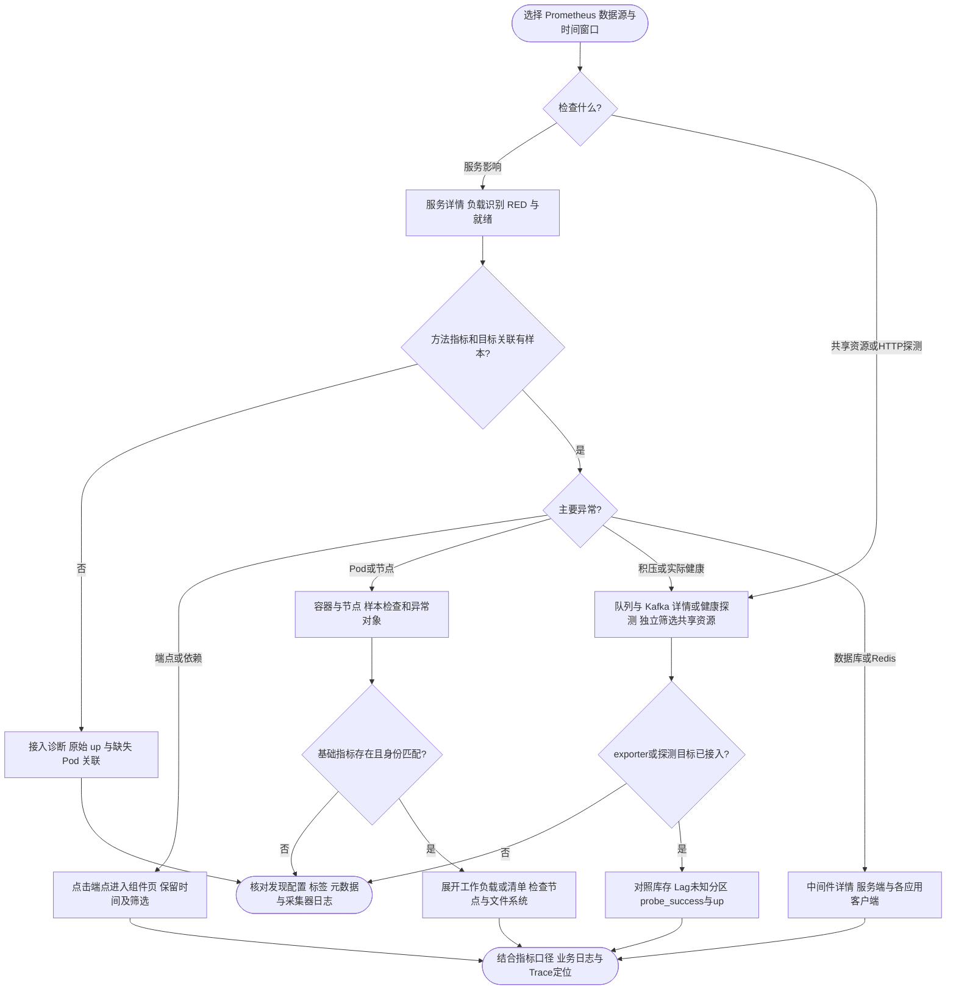

# 服务、资源与组件面板

九份 JSON 组成“一个平台总览 + 按资源类型的模板化详情页”：总览只放症状，详情页用变量切换对象，不为每个服务复制 JSON。导入时保留各自 UID；所有页面顶部导航相同（按 Folder 排序），跳转保留时间窗口与已有变量，目标页只使用自己声明的变量。页面清单、每页回答的问题和所需 exporter 见 [多项目监控与告警规划](fleet-monitoring.md#页面清单)。

| Folder | 页面 | 文件与 UID | 内容 |
| --- | --- | --- | --- |
| 00 总览 | 平台总览 | [foundation-fleet.json](grafana/dashboards/foundation-fleet.json)，`foundation-fleet-overview` | 当前告警、应用症状与健康表、K8s（未就绪 Pod、近 1h 重启、节点 NotReady/压力）、数据库、Redis、队列与 Kafka、网关质量 |
| 10 服务 | 服务详情 | [foundation-service.json](grafana/dashboards/foundation-service.json)，`ack-service-overview` | 负载识别；HTTP/gRPC RED、就绪、异常端点；消费者、Job、Runtime 分区；接入诊断 |
| 10 服务 | 网关详情 | [foundation-gateway.json](grafana/dashboards/foundation-gateway.json)，`foundation-gateway` | 入口 RED 与 429 比例、按路由诊断、按下游（client_requests）错误率/延迟与非 2xx 原因 |
| 10 服务 | 应用组件 | [foundation-components.json](grafana/dashboards/foundation-components.json)，`ack-application-components` | Server、Client、Cache、Job、Lock、OSS、Runtime |
| 20 中间件 | 数据库详情 | [foundation-database.json](grafana/dashboards/foundation-database.json)，`foundation-database` | mysqld_exporter 服务端；各应用客户端汇总；连接池与 SQL 操作（原组件页 Database 区块） |
| 20 中间件 | Redis 详情 | [foundation-redis.json](grafana/dashboards/foundation-redis.json)，`foundation-redis` | redis_exporter 服务端；各应用客户端汇总；连接池与调用（原组件页 Redis 区块） |
| 20 中间件 | 队列与 Kafka 详情 | [foundation-messaging.json](grafana/dashboards/foundation-messaging.json)，`foundation-messaging` | 症状卡片；共享 Queue 库存与 Kafka Lag（原共享页）；Queue/Kafka 应用处理（原组件页区块） |
| 30 基础设施 | 容器与节点 | [foundation.json](grafana/dashboards/foundation.json)，`ack-container-overview` | 对象状态、重启、Deployment 副本缺口、容器资源与节点容量 |
| 30 基础设施 | 健康探测 | [foundation-shared.json](grafana/dashboards/foundation-shared.json)，`foundation-shared-resources` | 实际 `/readyz` 与 `/healthz` HTTP 探测、探测器抓取状态 |

Folder 与文件的对应关系保存在 [folders.json](grafana/folders.json)，`render-kubernetes` 据此为每个 Folder 生成一个带 `grafana_folder` 注解的 ConfigMap；本地 Compose 仍全部放在 Foundation Folder。业务自定义指标页放 90 业务，复制模板时更换 UID 与标题，不覆盖公共模板。

## 页面判读与导航

平台总览面向整套项目都使用本框架的场景，只读 `foundation-records` 预聚合（见 [告警规则](alerts.md#recording-rules)）与 Prometheus 内置 `ALERTS`，未加载该规则组时整页无数据。自上而下：当前触发中的告警；有没有应用不可用或在报错；应用健康表每个应用一行，按未就绪实例数降序排列（就绪含 readiness 依赖检查，见 `app:readiness:ready`），点击应用名进入服务详情；K8s、数据库、Redis、队列与 Kafka、网关质量各一行，表格中的 Pod、节点、实例、消费组、队列、应用链接到对应详情页。表格中“—”表示该应用没有对应负载或暂无样本，不等于零；无流量时比例不出值；环境与集群列放在最后。当前告警表排除 Watchdog、InfoInhibitor 与 none/info 级别，显示 alerts.yaml 中的说明与已持续时间。exporter 未部署时对应卡片显示“未接入”；kube-state-metrics 或消费者已接入但没有异常时，异常计数显示 0 而不是“未接入”。

单个服务从服务详情开始：首行“负载识别”卡片显示该服务有哪些负载类型（HTTP/gRPC 端点、消费者、Job、Go Runtime）。Grafana 不能按是否有数据自动折叠分区，因此 HTTP/gRPC RED 默认展开，消费者、Job、Runtime 默认折叠，卡片有值时再展开；这三个分区按应用汇总，不受节点与视图影响，Job 分区另列 kube-state-metrics 的 K8s Job 失败（一次性脚本）。RED 首屏卡片汇总当前筛选范围，趋势保留应用身份。异常端点表只列当前有错误或请求样本的对象，可点击端点进入组件页；空表须结合流量与接入诊断判断。卡片不设置业务 SLO 阈值；抓取失败数大于零用红色，应用自报就绪（`app_ready`）或已发现 Pod 未全部就绪用橙色，流量、错误率和耗时用中性色。

容器与节点页按六区组织：全数据源样本检查、存活与异常、工作负载资源、节点资源、对象清单、应用指标简表。工作负载、对象清单和应用简表默认折叠；异常区优先展示未 Ready 对象、等待原因、最近 OOM 终止记录、状态时间线、窗口重启表和 Deployment 副本缺口。节点最满文件系统趋势下方保留 Top 10 表，定位节点、设备、挂载点、文件系统类型和可用空间。

组件页默认展开 Server，其他领域按需展开。端点表合并请求速率、窗口增量、5xx 比例和延迟；Runtime 结合内存、GC、调度等待和最忙进程 FD 利用率排障。Database、Redis、Queue、Kafka 区块已整体迁到中间件详情页，查询与面板 ID 不变，避免两处维护。

数据库与 Redis 详情分三区：exporter 服务端（按 `db_instance` / `redis_instance` 选择）、各应用客户端汇总表（每行一个应用的一个连接名，定位哪个应用占满连接或拖慢查询）、按视图下钻的连接池与操作明细。数据库连接池容量与最忙实例利用率组合判断局部耗尽；Redis 建连延迟单独展示，业务缓存命中率、Redis 连接池复用与服务端键空间命中率三者不同。服务端与客户端之间没有自动映射，建议平台约定 `db_name`、`redis_connection` 与实例别名一致。

网关详情按路由（网关 server operation）和下游展示；下游由 `client_requests_*` 的 operation 推导，gRPC 风格 `/pkg.Service/Method` 取服务名，其余保留完整 operation。非 2xx 表按状态码与 Kratos reason 拆分，用于区分超时、熔断与限流。

队列与 Kafka 详情的共享库存与 Lag 区不需要 Kubernetes 元数据，也不依赖四种视图：Queue 按逻辑目的地展示，Kafka 按真实集群、消费组、Topic、分区展示；下方 Queue/Kafka 应用处理区（默认折叠）保留四种视图。两者互为补充，处理成功不能证明没有积压或已提交位点。健康探测页把 HTTP 探测结果与探测器抓取状态分别展示。

该图描述面板导航与排障操作；日志需另行查看，不表示面板新增日志采集或日志事件。

## 变量与聚合范围

带视图的页面（服务详情、应用组件、容器与节点、中间件详情的应用区块）先选择数据源、命名空间和应用，再选择节点、Pod、容器及视图。可见变量“应用 Pod 标签”`app_pod_label` 提供固定白名单 `pod_name`、`pod`，默认 `pod_name`；按真实采集目标标签选择，无需编辑 JSON。ACK 常见 `pod_name`，仓库 ServiceMonitor 示例使用 `pod`。基础设施区直接使用标准 `pod`。

具体应用筛选要求目标带稳定 `app` 标签；All 允许缺少该标签的旧指标显示。应用曲线和端点表保留 `namespace`、`app`，Node 视图也不会把同节点不同应用混成一条曲线。多个服务缺少应用身份时仍无法可靠区分，变量不能弥补采集标签缺失。服务首屏卡片汇总所选范围，不是逐应用卡片。

| 视图 | 资源图例与聚合 | 应用曲线附加身份 |
| --- | --- | --- |
| Pod | namespace / pod；所选容器按 Pod 求和 | namespace、app |
| Container | namespace / pod / container | namespace、app |
| Node | node；工作负载区仅汇总该节点上所选工作负载 | namespace、app；应用及命名空间保持独立 |
| Instance（Pod IP） | namespace / pod / pod_ip | namespace、app；不是 exporter 抓取地址 |

视图作用于资源趋势与应用组件查询。Pod 阶段时间线始终逐 Pod 展示，独立于视图和容器筛选；Pod Ready、Running 和清单不受容器筛选影响。未调度 Pod 可出现在 Pod/Instance 视图，Node 视图显示“未调度”，IP 可能为空。

节点整机资源与状态只受节点筛选影响，忽略命名空间、应用、Pod、容器和视图。容器页的“应用”仅过滤底部应用埋点，不过滤 Kubernetes 对象。Deployment 表只受命名空间与 `deployment` 筛选影响，不推断 Deployment 与 `app` 的对应关系，也不受节点、Pod 或容器筛选影响。

服务页原始应用目标抓取时间线和无法关联 Kubernetes 的目标表不按节点筛选：关联失败时节点本来就未知，先过滤节点会隐藏故障。它们仍受命名空间、应用、Pod、容器和所选 Pod 标签影响。缺少所选 Pod 标签的目标及完全未发现的目标没有完整入口，需核对发现配置与控制器期望副本。

队列与 Kafka 详情的共享区使用 `env`、`cluster`、`queue_name`、`kafka_cluster`、`consumer_group`、`broker_topic` 筛选，不使用 `app/node/pod/container/view`；应用处理区使用应用变量与 `queue_name`、`queue_consumer`、`kafka_topic`、`kafka_consumer`。`broker_topic` 是 Broker 真实 Topic，`kafka_topic` 是应用指标的逻辑目的地，二者不能自动映射。健康探测页使用 `env`、`cluster`、`probe_app`。数据库与 Redis 详情的服务端区只受 `db_instance` / `redis_instance` 筛选，客户端区受应用变量与 `db_name` / `redis_connection` 筛选。网关详情使用 `namespace`、`app`（单选，只列有下游调用的应用，服务详情的应用会直接带入）、`route`、`client_operation`，按应用汇总，不受节点与视图影响。平台总览只有 `namespace` 与 `app`（网关区筛选）；节点、exporter 实例与 Kafka 区不受命名空间筛选，当前告警表选择具体命名空间时会隐藏不带 namespace 的告警。

## 接入契约

带视图的页面要求一个 Prometheus 数据源对应一个 Kubernetes 集群。聚合多个集群时须先隔离，否则同名 namespace/pod/node 可能被合并或产生多对多匹配。共享库存、Lag、exporter 与探测通过可靠的 `env/cluster` 区分采集范围；Kafka 另需稳定 `kafka_cluster`。变量是筛选工具，不是权限隔离。

| 来源 | 必要指标/标签 | 用途 |
| --- | --- | --- |
| kube-state-metrics | `kube_pod_info`：namespace/pod/node/pod_ip；`kube_node_info`：node | 对象发现及节点/IP 关联 |
| kube-state-metrics | Pod phase/ready、普通容器 running/waiting/restarts | 存活、就绪、异常与重启 |
| kube-state-metrics | `kube_pod_container_resource_limits`：namespace/pod/container/resource/unit | 容器 Limit 比例 |
| kube-state-metrics，可选 | `kube_pod_container_status_last_terminated_reason`、`kube_deployment_spec_replicas`、`kube_deployment_status_replicas_available` | 最近 OOM 记录与 Deployment 副本表 |
| kubelet/cAdvisor | CPU/Working Set：namespace/pod/container | 容器资源用量 |
| node-exporter | CPU、内存、文件系统、网络、磁盘；instance | 节点整机资源 |
| node-exporter | `node_uname_info`：instance + node 或 nodename | 优先 node，其次 nodename；须真实匹配 Kubernetes 节点名 |
| Foundation 应用 | 业务指标及 `up`：namespace/app/container、pod_name 或 pod | 应用与 Kubernetes 关联；Pod 标签须与可见变量一致 |
| Queue 观察器 | 显式 `RegisterStats`，逻辑目的地 `queue_destination` | 库存、统计成功与年龄可用性 |
| Kafka exporter | Lag：kafka_cluster/consumergroup/topic/partition；目标带 `foundation_kafka=true` | 已提交位点 Lag 与 exporter 抓取状态 |
| blackbox exporter | 目标带 `foundation_probe=true`、app、probe；请求 readyz/healthz | `probe_success`、HTTP 状态码、耗时与抓取状态 |
| mysqld_exporter，可选 | `mysql_up`、`mysql_global_status_*`、`mysql_global_variables_max_connections`、`mysql_slave_status_seconds_behind_*`；instance | 数据库详情服务端区、平台总览数据库行 |
| redis_exporter，可选 | `redis_up`、`redis_memory_*`、`redis_evicted_keys_total`、`redis_commands_*`、`redis_connected_clients`；instance | Redis 详情服务端区、平台总览 Redis 行 |
| Prometheus 规则 | `foundation-records` 预聚合、`ALERTS` | 平台总览全部查询 |

RSS、CFS 限流、OOM、Deployment 和部分节点指标可能未在当前平台启用，缺失时留空。ECI/虚拟节点可能没有 node-exporter，不能伪造物理机数据。exporter 接入见 [外部指标](external-metrics.md)；页面导航不会自动创建 exporter、探测目标或业务上报。

## 计算与状态边界

| 信号 | 当前含义与限制 |
| --- | --- |
| Ready / Running 与总数 | 容器页并列展示状态数量与所选已发现节点、Pod 或普通容器总数；Running 不等于 Ready，不含 init container。服务页 Ready 分母是已发现且可关联 Kubernetes 的应用采集目标 Pod，两者都不是期望副本数 |
| Deployment 副本缺口 | `max(期望副本-可用副本,0)`；可用副本不等于 Pod Ready。任一指标缺失保留空值，不把未知填零 |
| `up` 与 HTTP 探测 | `up=1` 仅证明抓取成功；`probe_success` 为实际 HTTP 探测结果，与 Pod Ready、方法结果分别判断 |
| 全数据源样本检查 | 首区检查整个数据源是否有近期样本，不受对象筛选影响；不能证明每个目标健康。仅这些存在性检查将缺失显式显示为 0 |
| 重启与 OOM | 重启 `increase[$__range]` 在所选窗口结束点求值，可能有小数；OOM 表表示最近终止原因为 OOMKilled，不是窗口 OOM 次数或当前 OOM |
| 状态时间线 | 布尔/枚举按对象展示，缺样本断开，不延续旧状态；容器运行数量趋势使用阶梯线 |
| 采集副本去重 | Kubernetes/cAdvisor 先按对象去副本，排除空 container 与 `POD` sandbox；节点核数按 instance/cpu 去重，网络/磁盘先按 instance/device 去重 rate 再求和 |
| Limit 与容器资源 | 比例仅纳入同时有使用量与正 Limit 的容器，无 Limit 不参与，全部无 Limit 时留空；CPU 是核，限流是周期比例，Working Set、cgroup RSS、进程 RSS 含义不同 |
| 节点资源 | 内存为 `1-MemAvailable/MemTotal`；Load/逻辑核数可超过 1，不是 CPU 百分比。文件系统按 instance/device/mountpoint/fstype 去副本；设备拓扑仍需核对 bond/bridge 和磁盘映射等重复设备 |
| RED 与分位数 | P95/P99 先合并同组桶再计算，不平均实例分位数。无请求时比例/分位数留空；有请求但无 5xx 序列时补同范围零。首屏分位数受所选流量构成影响 |
| 组件口径 | Redis 连接池复用不是业务缓存命中率，`status=error` 含 `redis.Nil`；Queue 单次尝试、一次领取执行与状态落库分别展示；DB/FD 先算实例利用率再取最忙实例，避免汇总掩盖局部耗尽 |
| 共享 Queue | 同库存多个 observer 取 max，不累加；采集/年龄状态取最差 observer。年龄只取同 observer 采集成功且年龄已知的样本，未知不能解释为空队列 |
| 逻辑 Store 身份 | 同一 env/cluster 的 `queue_destination` 必须唯一标识同一 Store；不同 Store 同名时 max 无法识别后端冲突，不保证库存正确 |
| Kafka Lag | 同分区去 exporter 副本后求 Topic 合计；负值是未知并单列，不能当 0。缺失分区仍可能低估总 Lag，抓取成功不保证分区返回完整 |

Pod 元数据需在查询时刻仍存在。短任务结束并删除后，较长窗口增量无法关联当前身份，会遗漏已消失对象；实时排障图不作为精确账单、SLA 或审计报表。当前上报仍有 Server panic、前置 Deadline 拒绝、Client.Do、gRPC Stream 等覆盖限制，Kafka 批量失败及 Job 取消结果也有口径限制；面板已标明，优化展示没有改变上报实现。

变量默认使用 `${pod}` 等插值，由 Prometheus 数据源转义；动态聚合 `${view:raw}` 仅取四项白名单，标签名 `${app_pod_label:raw}` 仅取 `pod_name/pod`，不接受任意 PromQL。

## 验证与验收

仓库根目录执行 `make test-observability`。固定 Prometheus 镜像中的 promtool 校验 JSON、九页统一顶部导航（`includeVars`/`keepTime`）、面板与数据链接目标、Folder 映射、变量引用、平台总览只读预聚合、四种视图查询，并以合成样本检查身份隔离、去重、Limit、窗口增量、状态、节点关联、共享计算、下游推导，以及每个新页在 exporter 未接入时的空数据表现（“未接入”与补 0 的区别）。覆盖范围以 [check_dashboards.py](../test/observability/check_dashboards.py) 的实际断言为准；空查询通过不能证明非空数据计算正确。

离线校验不访问真实 ACK、Broker 或健康接口，不替代浏览器的变量插值、状态颜色、表格合并、默认折叠与导航验收。真实联调使用 `make observability-smoke PROMETHEUS_URL=...`；可选 `GRAFANA_URL=...` 核对已加载 JSON。它验证查询与配置版本，不保证指标覆盖完整或每张图呈现正确。接入、工具与命令前置条件见 [入口文档](README.md)。

指标契约参考：[阿里云基础指标列表](https://www.alibabacloud.com/help/en/prometheus/developer-reference/container-cluster-metrics)、[ACK 可观测最佳实践](https://help.aliyun.com/zh/ack/ack-managed-and-ack-dedicated/user-guide/observability-best-practices)、[kube-state-metrics Pod 指标](https://github.com/kubernetes/kube-state-metrics/blob/main/docs/metrics/workload/pod-metrics.md)、[Node 指标](https://github.com/kubernetes/kube-state-metrics/blob/main/docs/metrics/cluster/node-metrics.md)。这些来源不是当前集群接入或视觉验收的证明。
