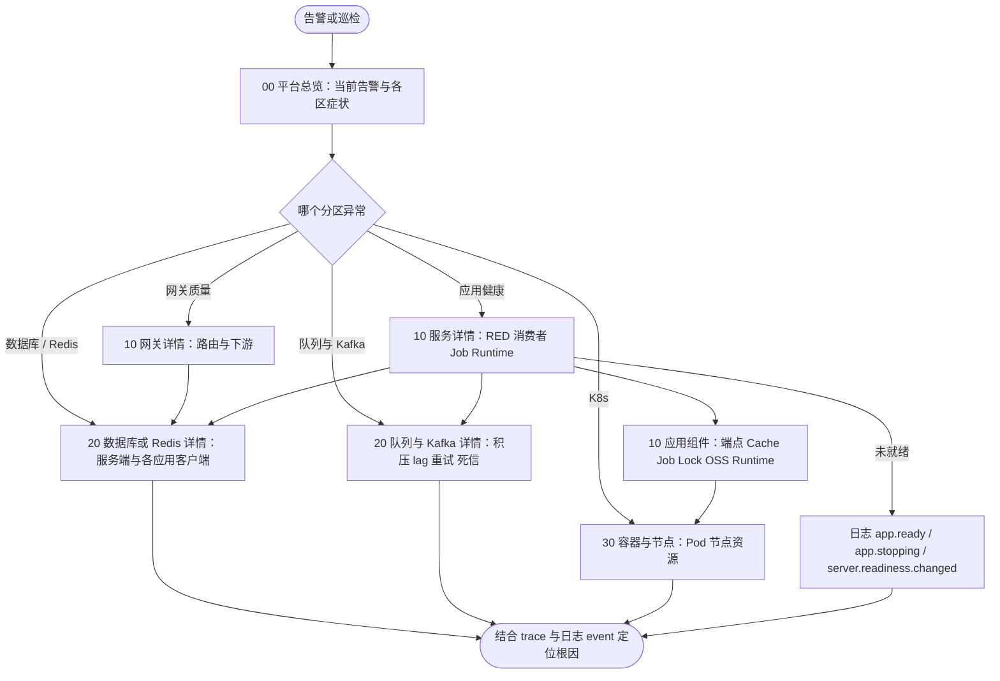
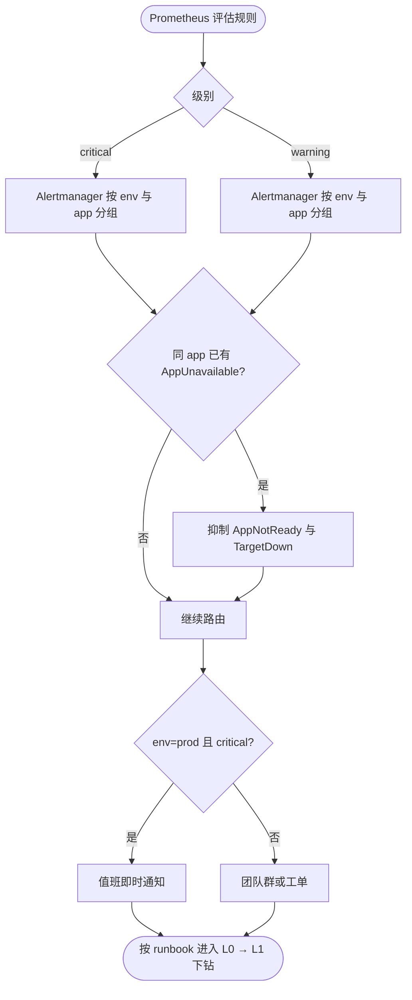

# 多项目监控与告警规划

本文规划“整套项目都基于 Foundation”时的面板分层、各类负载的观测重点与告警体系。已落地的规则见 [alerts.md](alerts.md)，面板现状见 [dashboard.md](dashboards.md)；本文中标注“规划”的部分尚未实现。

## 设计原则

1. **统一身份标签**：所有指标经采集重标为 `env`、`cluster`、`namespace`、`app`、`pod`。告警、面板与 Alertmanager 路由只按这组标签聚合，跨项目的面板才能复用同一套查询。
2. **先看症状再看原因**：顶层只放用户可感知的症状（可用性、错误、延迟、积压、任务失败），组件与资源指标放在下钻层。
3. **告警分两级**：critical 只给“服务已经不可用或 SLO 快速消耗”，需要立刻有人处理；warning 是需要当天处理的异常，进群或工单，不半夜叫人。
4. **按负载类型选信号**：HTTP、gRPC、网关、队列消费者、一次性脚本、常驻进程的“健康”含义不同，不能只用请求 RED 判断所有服务。
5. **跨负载统一的就绪信号**：`app_ready` 与 HTTP `/readyz`、gRPC 健康检查读取同一状态，是唯一对所有负载类型都成立的“应用是否可用”信号。

## 面板分层

一个平台总览只放症状，详情按资源类型做成模板化页面，用变量切换服务、数据库实例、Redis 实例、队列或网关；不为每个服务复制一份 JSON。所有页面顶部导航相同，跳转时携带同名变量（`includeVars`）与时间范围（`keepTime`）。

### 页面清单

| 文件夹 | 页面与 UID | 回答的问题 | 所需 exporter / 规则 |
| --- | --- | --- | --- |
| 00 总览 | [平台总览](grafana/dashboards/foundation-fleet.json) `foundation-fleet-overview` | 现在哪里有问题：哪些告警在触发、哪个应用不可用或在报错、哪些 Pod/节点异常、哪个数据库/Redis/消费组/下游在恶化 | 只读 `foundation-records` 预聚合与 `ALERTS`；K8s 区需 kube-state-metrics，数据库区需 mysqld_exporter，Redis 区需 redis_exporter，Kafka lag 需 kafka-exporter；缺失的区块显示“未接入” |
| 10 服务 | [服务详情](grafana/dashboards/foundation-service.json) `ack-service-overview` | 这个服务哪里不好：HTTP/gRPC RED、消费者、Job、Runtime 中哪类负载出问题 | Foundation 应用指标、kube-state-metrics（Pod 关联） |
| 10 服务 | [网关详情](grafana/dashboards/foundation-gateway.json) `foundation-gateway` | 网关入口哪个路由在报错/变慢、是哪个下游拖垮网关、限流比例是否突增 | Foundation 应用 `server_requests_*` 与 `client_requests_*` |
| 10 服务 | [应用组件](grafana/dashboards/foundation-components.json) `ack-application-components` | 进程内哪个组件出问题：Server/Client 端点、Cache、Job、Lock、OSS、Go Runtime | Foundation 应用指标、kube-state-metrics |
| 20 中间件 | [数据库详情](grafana/dashboards/foundation-database.json) `foundation-database` | 这个 MySQL 实例是否饱和、慢查询或复制落后；是哪个应用占满连接或拖慢查询 | mysqld_exporter（服务端，可缺）、应用 `go_sql_*` / `database_sql_*`（客户端） |
| 20 中间件 | [Redis 详情](grafana/dashboards/foundation-redis.json) `foundation-redis` | 这个 Redis 实例内存、逐出、延迟、连接是否异常；是哪个应用的连接池在等待或超时 | redis_exporter（服务端，可缺）、应用 redisotel `db_client_connections_*`（客户端） |
| 20 中间件 | [队列与 Kafka 详情](grafana/dashboards/foundation-messaging.json) `foundation-messaging` | 哪个队列/消费组在积压、最老任务等了多久、哪个消费者在重试或进死信 | Queue `RegisterStats` 观察器、kafka-exporter（lag，可缺）、应用 `queue_*` / `kafka_*` |
| 30 基础设施 | [容器与节点](grafana/dashboards/foundation.json) `ack-container-overview` | Pod、Deployment 副本或节点资源是否异常 | kube-state-metrics、kubelet/cAdvisor、node-exporter |
| 30 基础设施 | [健康探测](grafana/dashboards/foundation-shared.json) `foundation-shared-resources` | 实际 `/readyz`、`/healthz` HTTP 探测是否成功、探测器自身是否可用 | blackbox-exporter |
| 90 业务 | 各业务自建 | 业务自定义指标（订单量、支付成功率等） | 业务埋点；不进本模板，复制模板时更换 UID |

### 分层与职责

- **总览只放症状**：每个分区的表格或卡片链接到对应详情页；总览不画趋势细节，也不读取原始直方图，几十个应用时依然秒开。
- **详情按资源类型模板化**：服务详情按负载类型分区（HTTP/gRPC RED、消费者、Job、Runtime），Grafana 不能按是否有数据自动折叠，因此除 RED 外的分区默认折叠，首行“负载识别”卡片标明哪些分区有数据。数据库、Redis 详情并列服务端 exporter 指标与各应用客户端连接池/耗时，按应用拆分以定位“哪个应用压垮了数据库”。
- **不重复维护**：原组件页的 Database、Redis、Queue、Kafka 区块整体迁到对应中间件详情页（查询与面板 ID 不变），组件页只保留进程内组件；原共享资源页的 Queue 库存与 Kafka lag 迁到队列与 Kafka 详情，该 UID 只保留健康探测。
- **服务端与客户端不能自动对应**：exporter 的 `instance` 与应用的逻辑名（`db_name`、`redis_connection`）之间没有可靠映射，详情页用两个独立变量选择，建议平台约定两者同名。
- **Folder 建议**：00 总览 / 10 服务 / 20 中间件 / 30 基础设施 / 90 业务。`render-kubernetes` 按 [folders.json](grafana/folders.json) 为每个 Folder 生成一个带 `grafana_folder` 注解的 ConfigMap；业务页面放 90 业务，自行维护。

L0 是多项目场景下最关键的一层。它只依赖下文的 recording rules 与 `ALERTS`，每行链接到 L1 或对应详情页并带上命名空间、应用或实例。

## 各类负载的观测重点

| 负载 | 关键指标 | 告警（已有 / 规划） |
| --- | --- | --- |
| HTTP 服务 | `server_requests_code_total`、`server_requests_seconds`、`app_ready`、DB/Redis 池 | TargetDown、AppNotReady、AppUnavailable、HighServerErrorRate、HighLatency、SLOBurnRateCritical / SLOBurnRateWarning（可用性）、LatencySLOBurnRateCritical / Warning（>1s）、DownstreamHighErrorRate / HighLatency |
| gRPC 服务 | 同上（`kind=grpc`）；gRPC 健康检查已与 `app_ready` 联动 | 同 HTTP；K8s 使用原生 gRPC 探针 |
| API 网关 | 入口 RED + 出口 `client_requests_seconds`（按下游 target）、429 限流、熔断打开 | 同 HTTP；规划：单下游错误率/延迟（定位“哪个后端拖垮网关”）、限流比例突增 |
| 队列消费者（Queue/Kafka） | `queue_consumer_*` / `kafka_consumer_*` 吞吐与失败、重试、死信、`queue_oldest_ready_age_seconds`、Kafka lag、`app_ready` | QueueRuntimeFailure、KafkaRuntimeFailure、QueueReadyTooOld、KafkaLagHigh、AppNotReady；规划：死信速率 >0、失败率阈值 |
| 一次性脚本 | 进程退出码；K8s `kube_job_status_failed`、`kube_cronjob_next_schedule_time`、`kube_cronjob_status_last_successful_time`、`kube_job_status_active`；可选 `metrics.push` 推送的 `job_runs_total` | JobFailed、CronJobMissedSchedule、CronJobNoRecentSuccess、JobRunningTooLong（kube-state-metrics，不依赖框架指标） |
| 自定义常驻进程 | `app_ready`、容器重启、业务自定义指标 | AppNotReady、AppUnavailable、TargetDown；业务按自身语义补充 |

一次性脚本的结果以 K8s Job 状态和日志 `app.stopped result=failed` 为准：进程退出前 Prometheus 往往来不及抓取。告警见 [一次性脚本与 CronJob 告警](alerts.md#一次性脚本与-cronjob-告警)；需要框架内指标时为该进程开启 `metrics.push`，在应用结束后推送到 Pushgateway 一次（只描述最近一次运行，失败不改变退出码）。

## 告警分级与路由

| 级别 | 规则 | 通知 |
| --- | --- | --- |
| critical | FoundationAppUnavailable、FoundationSLOBurnRateCritical（1h/5m 14.4 倍、6h/30m 6 倍） | 电话/值班即时通知 |
| warning | FoundationAppNotReady、TargetDown、HighServerErrorRate、HighLatency、消费积压与运行时故障、Job 失败、K8s Job/CronJob 失败与调度异常、DB/Redis 池饱和、FoundationSLOBurnRateWarning（1d/2h 3 倍、3d/6h 1 倍） | 团队群或工单，工作时间处理 |

- **分组**：应用告警按 `alertname, env, cluster, namespace, app`，节点告警按 `alertname, env, cluster, node`，同一 app 的多实例合并为一条通知。K8s Job/CronJob 告警按 `alertname, env, cluster, namespace, owner_name`（或 `cronjob`）分组，同一 CronJob 的多次失败合并；`app` 需 kube-state-metrics 放开 `app.kubernetes.io/name` 才有值。
- **抑制**：同 app 的 FoundationAppUnavailable 抑制 FoundationAppNotReady 与 TargetDown；节点不可用抑制该节点上的应用告警，避免一次故障刷屏。
- **路由**：按 `env` 分流（prod 才允许 critical 呼叫），按 `namespace` 或团队标签路由到对应负责人；每条告警的 `runbook` 指向 [troubleshooting.md](troubleshooting.md) 的锚点。

## SLO 与 recording rules

每个 app 按负载类型定义一个可用性 SLO（例如 99.9%）和一个延迟 SLO（例如 P99 < 1s 的请求占比 99%）。为避免 L0 面板和告警在几十个 app 上重复计算原始直方图，已用 `foundation-records` 组预聚合 5m 速率、延迟桶、就绪实例、消费失败、Job 失败与最老就绪任务，规则清单见 [alerts.md](alerts.md#recording-rules)。比例与分位数在查询时由计数求得，不预存比值，避免跨应用再聚合时出错。

可用性 SLO 已由 `foundation-slo` 组实现：`app:server_error_ratio:rate5m…3d` 多窗口错误比例，1h/5m 超过 14.4 倍或 6h/30m 超过 6 倍为 critical，1d/2h 超过 3 倍或 3d/6h 超过 1 倍为 warning，默认 SLO 99.9% 由 `foundation:slo_error_budget:ratio` 调整，见 [可用性 SLO 消耗率告警](alerts.md#可用性-slo-消耗率告警)。长窗口请求少于 100 次时不告警，低流量服务配合端到端探测或业务成功事件。延迟 SLO 用同一套窗口统计慢于 1s 的请求比例，平台总览健康表显示 1h 可用性与延迟消耗率。

## 落地顺序

1. 已完成：`app_ready` 指标、FoundationAppNotReady / FoundationAppUnavailable 告警及规则测试、gRPC 健康检查与就绪联动、Runtime panic 统一停机。
2. 已完成：`foundation-records` recording rules 及规则测试、L0 舰队总览面板、L1 首行 `app_ready` 就绪率；[check_dashboards.py](../test/observability/check_dashboards.py) 加载同一份规则文件，用合成原始样本验证舰队页与 L1 就绪率。
3. 已完成：一次性任务的 K8s Job/CronJob 告警（`foundation-kubernetes-jobs` 组及规则测试，kube-state-metrics `metricLabelsAllowlist` 示例），以及可选的退出时 Pushgateway 推送 `metrics.push`（默认关闭）。
4. 已完成：平台总览扩展（当前告警、K8s、数据库、Redis、队列与 Kafka、网关质量分区及对应预聚合）与按资源类型的模板化详情页（服务、网关、数据库、Redis、队列与 Kafka）；[check_dashboards.py](../test/observability/check_dashboards.py) 校验统一导航、Folder 映射与链接目标，并为每个新页提供含 exporter 未接入的合成样本断言。
5. 已完成：可用性 SLO 多窗口多消耗率告警（`foundation-slo` 组及规则测试）。
6. 已完成：延迟 SLO 消耗率告警、单个下游错误率/延迟告警（`foundation-downstream`）、[Alertmanager 分组/抑制示例](alertmanager/alertmanager.example.yaml)及 amtool 路由校验、平台总览健康表的 1h 消耗率列。
7. 已完成：panic 与配置拒绝的 `log_events_total{event}` 计数及 FoundationPanicRecovered / FoundationConfigRejected 告警，原先只有日志的异常也能告警。
