# app

`pkg/app` 定义应用依赖、配置与构造函数。它保存构造期的 `Spec`、启动期固定的 `Config`、可热更新的 `StopPolicy`，并构造自管生命周期的应用。业务 Wire 层显式选择启用哪些组件；`pkg/app` 不自动发现组件，也不依赖具体的 AppInfo、Tracing、Metrics、Server 或 Job 包；日志接受 Kratos 契约，并识别 Foundation Logger 的固定模块派生能力。

`App` 自行实现 Run/Stop 生命周期，不再包装 `kratos.App`；`NewApp` 与 `bootstrap.NewApp` 均返回 `*app.App`，提供 `Run`、`Stop`、`ID`、`Name`、`Version`、`Metadata` 和 `Endpoint`。`*app.App` 实现 `kratos.AppInfo`，Runtime、钩子和请求 Context 中仍可通过 `kratos.FromContext` 读取应用身份。业务 injector 的返回类型由 `*kratos.App` 改为 `*app.App`，`main` 中的 `app.Run()` 用法不变。

- `app.go`：App 状态、身份访问器与构造函数。
- `hooks.go`：停止请求、停止前钩子、故障记录与启动钩子。
- `runtime.go`：Run 主流程、端点解析、Runtime 并发启停、启动前回滚与最终汇总。
- `spec.go`、`config.go`、`stop_policy.go`：应用描述、配置和停机策略。
- `registrar.go`：服务注册、补偿注销与 Registrar 选择。

`Runtime` 保留现有 `Start/Stop` 登记接口；有启动前资源的运行时可选实现 `AbortStartup(context.Context) error`，用于幂等释放尚未启动的资源，不需要增加 App 对具体领域包的依赖。

## 构造边界

本包描述应用所需依赖并提供 `NewApp(ctx, spec, config, stopPolicy, registrar)`，不选择领域组件、不聚合 Bootstrap，也不决定整个应用的组装阶段。所有阶段标记（包括用户提供的 `bootstrap.Bootstrap`）均定义在组装包。

应用组装与 Wire 示例见 [`bootstrap`](../bootstrap/README.md)。`NewApp` 消费已登记的 Spec 并冻结它；直接调用时由调用方保证贡献已全部完成。

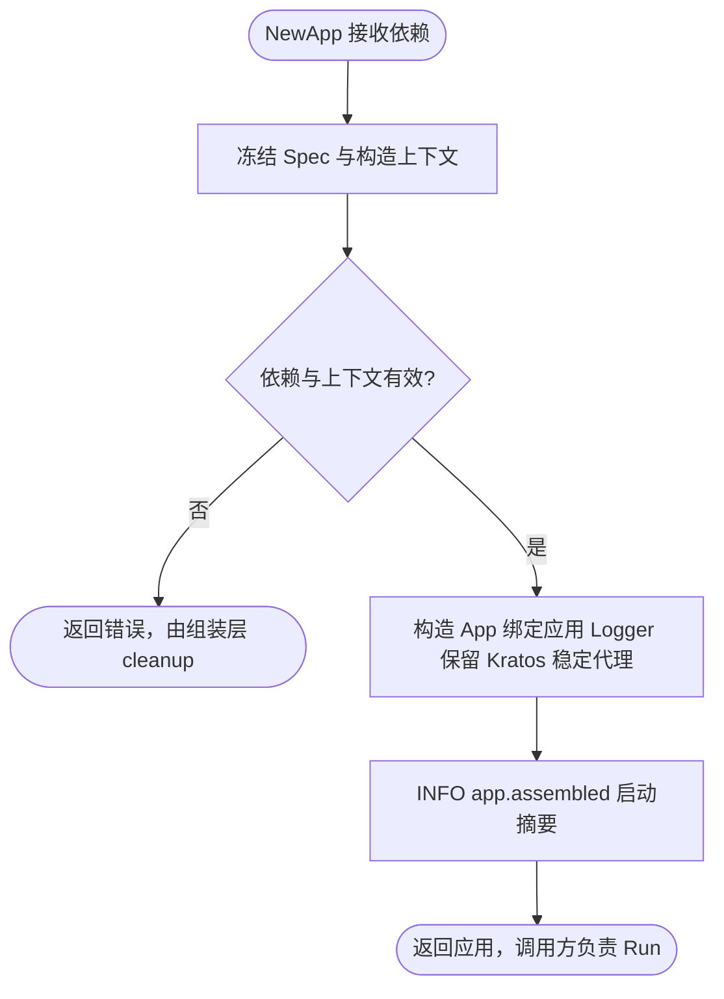

## 贡献和所有权

- `bootstrap.NewAppInfoBootstrap` 登记 AppInfo，并通过 `log.RegisterFields` 加入进程共享的 service ID、name、version 与 env 字段。
- `bootstrap.NewTracingBootstrap` 通过 `log.RegisterFields` 加入进程共享的 `trace.id` 和 `span.id` 动态字段。
- `bootstrap.NewMetricsBootstrap` 追加 ContextDecorator，把 Meter 注入由 `NewApp` 基于调用方 Context 组装的 App Context。配置 `metrics.push.url` 时它还登记一个停止后钩子，在全部 Runtime 退出后向 Pushgateway 推送一次；推送失败只记录 WARN、钩子返回 nil，不计入 `Run` 的错误汇总，见 [Metrics 推送](../metrics/README.md#一次性进程推送到-pushgateway)。
- `bootstrap.NewLogBootstrap` 登记应用 Logger、替换全局 Logger，并返回恢复先前全局 Logger 的 cleanup。
- `bootstrap.NewServerBootstrap` 登记启用的业务 HTTP/gRPC Runtime 和独立管理监听；`bootstrap.NewJobBootstrap` 仅在 Manager 有任务时登记 Job Runtime。
- 可选 `registry.Registrar` 由业务/Wire 通过 `NewApp`（或 `bootstrap.NewApp`）的构造参数注入；传入 nil 或调用 Spec.DisableServiceRegistration 表示禁用服务注册，组装层由 `app.NewRegistrar` 从具名 Registry Factory 解析实例；`app.registry` 省略或为空时使用 default，必须配置 `registry.instances.default`，缺失即报错。空名称不表示禁用，驱动禁用时返回 nil。

`Spec.RegisterLogger` 保存借用的原 Logger，`NewApp` 单次派生带 `module=app` 的生命周期视图；
原 Logger 不被修改，派生视图共用原输出且不增加 cleanup。App 生命周期和 StopPolicy 日志归属 `app`，保留本应用登记的 Logger 和身份字段。
`NewApp` 禁用 `kratos.New` 的全局 Logger 安装副作用，不再临时设置或恢复全局绑定。经 Foundation `log.SetLogger` / Bootstrap 安装后，Kratos 全局日志适配器仍然保留，HTTP/gRPC 启停日志归属 `kratos`；入口与覆盖规则见 [日志文档](../log/README.md#字段过滤与去重)。

构造函数拥有资源创建，Wire 接收并逆序调用其 cleanup。Bootstrap 本身通常没有 cleanup；例外是 `bootstrap.NewLogBootstrap` 的全局 Logger 恢复函数。Runtime 的 `Start`/`Stop`、Hook、Registrar 补偿和停机预算由 App 直接管理。

## Spec 约束

`RegisterRuntime(runtime)` 无需名称，按登记顺序保留全部 Runtime，不对同一实例去重；调用方应保证 Runtime 实例非 nil，登记时不作 nil 校验，冻结后的登记会 panic(app.ErrSpecFrozen)。重复登记可能导致重复启动，同一实例应只登记一次。`AddContext(decorate)` 无需名称，按登记顺序执行全部 ContextDecorator，重复登记也会重复执行；调用方应保证装饰函数非 nil，冻结后的新贡献会 panic(app.ErrSpecFrozen)。装饰函数返回 nil Context 时，错误包含从 1 开始的登记序号。所有公开登记方法均无返回值；AppInfo 和 Logger 是单例贡献，重复登记会 panic；Registrar 是独立的构造依赖，不保存在 Spec 中。组装层通过最终 `bootstrap.StartupReady` 屏障调用 `bootstrap.NewApp`，后者调用 `app.NewApp` 冻结 Spec；之后不能再注册 Runtime、Context、元数据、信号或 Hook。冻结后的空参数写入同样会 panic，Ready 仍可正常读取。

登记与冻结继续使用同一互斥锁保护共享状态；发生 panic 时 defer 释放锁，不留下半次登记。ContextDecorator 仍在锁外执行。`NewApp` 继续返回构造错误，包括重复消费 Spec 的 ErrSpecFrozen、缺失依赖和装饰函数返回 nil Context；这与公开登记方法的 panic 契约不同。

### 独立关闭服务注册

一次性 Job 可在构造应用前调用 `spec.DisableServiceRegistration()`（`app.Spec` 和 `bootstrap.Spec` 均提供）。
默认不关闭；显式关闭优先于注入的非 nil Registrar，App 不再调用 Register/Deregister，
并记录 `DEBUG event=app.registration.disabled`，日志自带 `caller`。重复声明安全，冻结后调用会 panic(app.ErrSpecFrozen)，不支持热更新。
该开关与 `ExitWhenDone` 独立，不改变 HTTP/gRPC、健康监听或客户端发现。

开关仅作用于 App 使用 Registrar 的阶段，不跳过 Wire 中 Registrar provider 与 Registry Factory 的构造或配置校验；
默认 provider 仍要求有效的具名实例。共享注册中心资源仍由原 provider 的 cleanup 释放。

需要由配置关闭时，将 `app.registry` 指向内置 `driver: "null"` 的实例，默认 provider 会返回 nil Registrar；可让客户端继续选择其他实例的发现能力。该选择需重启，完整示例及实例边界见 [Registry 配置关闭注册](../registry/README.md#通过配置关闭服务注册)。

### 注册名与端点

注册端点只来自 Runtime：按登记顺序查询实现了 `Endpointer` 的 Runtime，跳过 `RegistrationExempt()` 为 true 的（如管理端口）。对外地址与监听地址不同时，用 `server.http.endpoint` / `server.grpc.endpoint` 按 Server 覆盖。`App.Endpoint()` 返回全部可注册端点。

实例按 [`servicename`](../servicename/README.md) 规则推导的服务名注册，每个服务名只挂载承载它的端点：

- Runtime 汇报的未映射入口（如未在 proto 声明的手写路由）与未实现 `ServiceNamer` 的 Runtime 归入应用名（`APP_NAME` 或可执行文件名），并输出 WARN `app.registration.unmapped`；
- 没有业务服务的端点（如只有框架服务的 gRPC Server）不注册，Queue、Cron 等没有端点的进程不注册任何实例；
- 服务名推导失败（如 proto 位于版本目录）时启动失败。

服务名等于应用名的实例使用应用实例 ID，其余为 `<应用实例 ID>@<服务名>`；每个实例的元数据在应用元数据之外带 `app_name` 与 `process_id`（`app.MetadataAppName`、`app.MetadataProcessID`），同一进程的实例取值相同。注册前输出 INFO `app.registration.planned`，列出每个实例的名字与端点。

实例按应用名在前、其余按名字排序依次注册；任一实例注册失败时注销已注册的实例再返回错误，注册中心不会残留部分名字。停止时注销全部已注册实例，每个实例最多注销一次，注销错误逐个参与最终汇总。

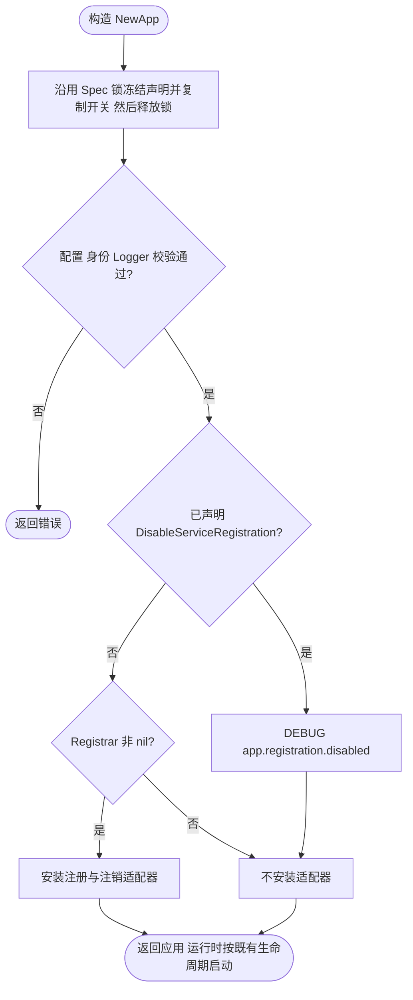

## 运行时故障与停止结果

`Run` 依次执行：解析端点 → BeforeStart → 并发启动 Runtime → 注册服务 → AfterStart 并发布 Ready → 等待停止请求 → 停止前钩子与注销 → 按冻结预算并发停止 Runtime → 等待全部 Start/Stop 返回 → AfterStop。系统信号与父 Context 取消从 `Run` 开始即转为统一停止，因此启动阶段收到 SIGTERM 同样执行停止钩子与回滚，而不是被 Go 默认信号处理直接终止。

只有错误树全部为 `context.Canceled` 的结果按正常停止处理；Runtime 的 Start/Stop 真实故障按发生顺序全部保留（根因在前），最终与停止前钩子、注销、等待超时和 AfterStop 错误通过 `errors.Join` 返回。`Stop` 和停止前钩子只执行一次，App 在最终汇总边界记录一次 app.stopped。启动阶段（注册或 AfterStart）失败时，等待 Runtime 退出受冻结的 `app.stop_timeout` 约束，超时返回 `context.DeadlineExceeded` 后继续收尾；正常运行后的停机等待全部 Start 返回。

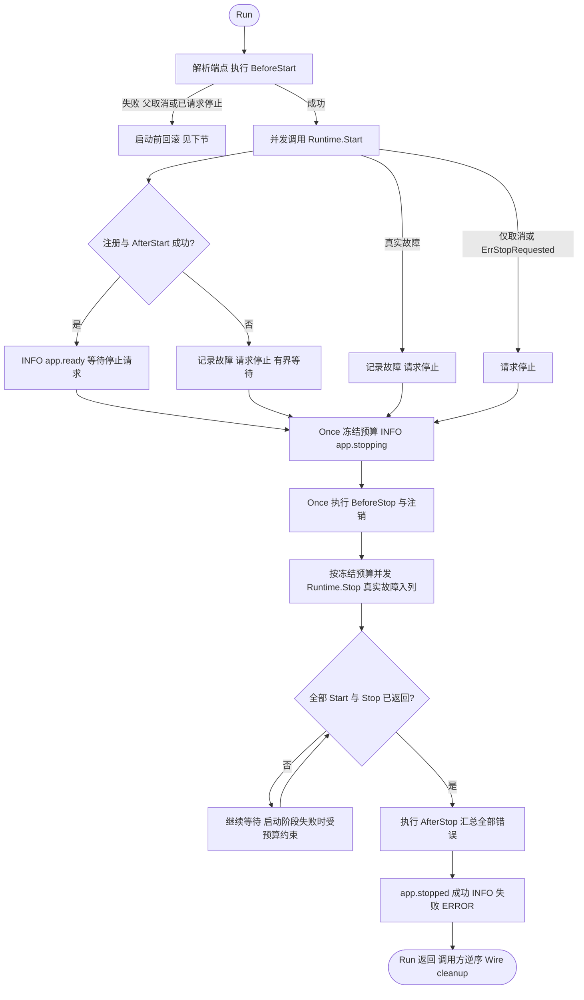

### 停机排空与取消边界

停机入口包括 `App.Stop()`、父 Context 取消、默认 `SIGINT/SIGQUIT/SIGHUP/SIGTERM`、Runtime 真实失败、启动钩子或注册失败，以及 Once 全部成功后由 Bootstrap 发出的 `ErrStopRequested`。`SIGKILL`、进程崩溃和机器故障不会执行这些清理步骤。

`App.Stop()` 发起停机，执行停止前钩子和注销后返回（重复调用共享第一次的结果）；它不等待所有 Runtime 停止。调用方应等待 `Run()` 返回，再逆序执行 Wire cleanup。首次请求立即撤销 Ready，随后各 Runtime 的 Stop 并发执行，不能依靠登记顺序让 Worker 等待 HTTP 在途请求全部完成。若请求还会投递或直接使用同一后台组件，业务应在停止前钩子中协调其依赖顺序。

| 组件 | 在途工作的处理 | 超时与失败边界 |
| --- | --- | --- |
| HTTP 与管理 HTTP | `server.stop_delay` 后关闭监听和空闲连接，`Shutdown` 等待活跃请求返回；App 不提前取消请求的基础 Context | 预算耗尽调用 `Close`，连接被关闭；忽略 Context 的 Handler 仍可能运行 |
| gRPC | 同样等待 stop_delay，然后 `GracefulStop` 停止接收新 RPC 并等待在途调用 | 预算耗尽调用底层 `Stop`，取消 RPC；不保证业务计算成功完成 |
| WebSocket | HTTP Shutdown 之前拒绝新连接，取消现有连接 Context、关闭 socket，等待读循环、在途回调及 OnClose | 超时直接关闭 socket 并返回错误；不能强制结束不响应取消的业务回调 |
| Queue Worker | 停止领取并取消 Handler Context，等待领取循环与 Handler 返回 | 不保证处理成功；停止中未确认任务靠租约恢复，业务可能重投，必须幂等 |
| Kafka ConsumerRuntime | 取消消费 Context，等待消费循环退出；内置消费者在关闭 SDK 前退出消费组 | 停止时取消的处理不提交位点、不发送死信；后续可能重投；自定义 Consumer 须遵守相同退出契约 |
| Job Once/Cron/Daemon | Stop 或父 Context 取消会触发任务的 `ctx.Done()`，停止调度并等待已启动任务退出 | 任务须响应取消；Once 取消后的真实失败仍通过 ErrorHandler 上报，Job 没有持久化恢复保证 |

`app.stop_timeout` 默认 30s，在首次停止时冻结；每个 Runtime.Stop 从调用时起分别获得该预算。`server.stop_delay` 默认 0s，会占用服务器的这份预算；WebSocket 与 HTTP 也共享同一个服务器预算。BeforeStop、Registrar 注销、AfterStop 和 Wire cleanup 有各自的执行边界，不受这一个数值统一限制。当前固定版本 Kratos 在 HTTP/gRPC 强制关闭成功后也可能返回 nil；`Run()` 返回 nil 不能证明请求已全部完成，应结合 force stop 的 WARN 日志判断。尤其是自定义 Runtime/Handler 忽略 Context 时，Stop 可超时返回，但 Start 仍可能阻塞，`Run()` 也可能持续等待；Go 不会强杀这些 goroutine。部署的进程终止宽限期须覆盖注销、流量传播、任务退出和资源释放。

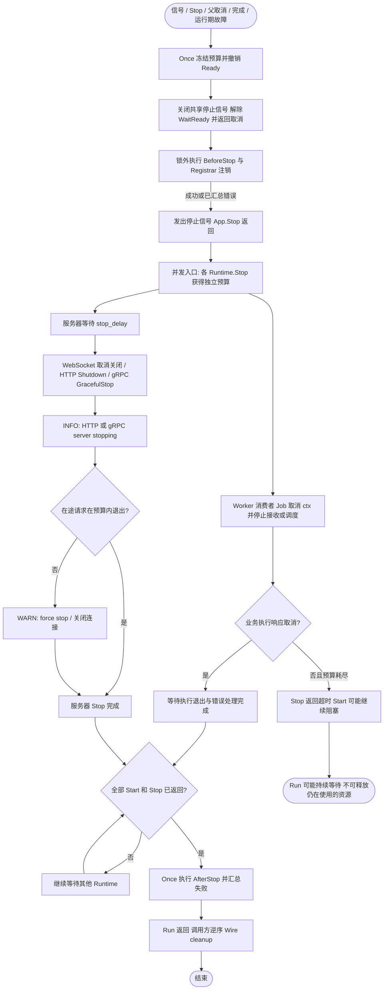

数据库、Redis、Kafka 客户端、配置监听、Tracing/Metrics 和日志输出的释放由各自 provider 的 cleanup 负责；Runtime.Stop 不代替这些 cleanup。详细契约见 [Server](../server/README.md)、[Queue](../queue/README.md)、[Kafka](../kafka/README.md) 和 [Job](../job/README.md)。

### 启动前资源回滚

`Run` 在 `BeforeStart` 之前解析 Runtime 的 Endpoint；此时可能已经打开监听，但尚未调用 `Start`。解析失败时进入统一停止，`BeforeStart` 的失败、已取消的父 Context 和启动前停止请求也使用相同路径。先广播 stopping 并执行一次 `BeforeStop`，再按冻结时的 Runtime 登记顺序逆序调用可选的 `AbortStartup`，全部回滚后才执行一次 `AfterStop`。遍历完整的原始 Runtime 列表，包括当前解析失败的端点和还未查询的端点；未实现该可选方法的普通 Runtime 不会被调用 `Stop`。

回滚 Context 保留父上下文值和应用身份（`kratos.FromContext`），脱离原取消状态，并为整轮逆序回滚设置首次停止时冻结的 `app.stop_timeout` 预算。一个回滚失败或预算到期后，仍调用其余回滚方法并汇总错误；实现须响应取消，App 不能强制终止永久阻塞的回调。原始启动错误、停止钩子错误和回滚错误通过 `errors.Join` 保留，启动前父 Context 已取消仍返回 `context.Canceled`。本路径返回错误；回滚结果使用 app.startup.aborted / app.startup.abort.failed，最终启动故障由 app.stopped 汇总。

这一保证适用于通过 Foundation 监听控制器持有、并由 `NewApp` 监督的 HTTP 业务及管理 Runtime。单独构造的原生 Kratos Server、自定义 Runtime 和 gRPC 未纳入 HTTP 监听接管；只有它们自行实现 `AbortStartup` 时，App 才能回滚其启动前资源。正常启动之后继续由 `Runtime.Stop` 管理停止，Wire cleanup 仍由调用方在 `Run` 返回后逆序执行。

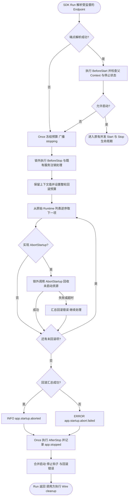

### Context 登记与应用

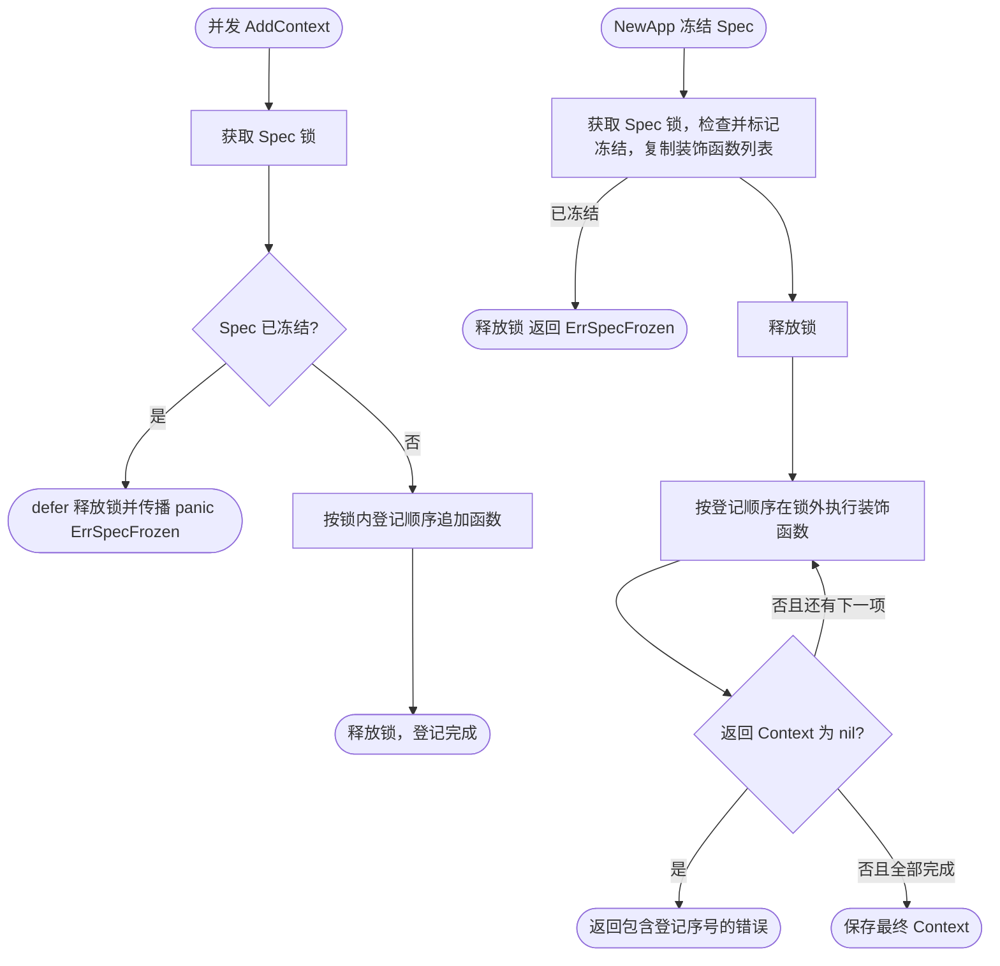

构造错误由调用方处理；冻结后的登记属于编程错误，panic 不转换为 error，此处不重复记录日志。锁不覆盖装饰函数调用。

### Runtime 登记

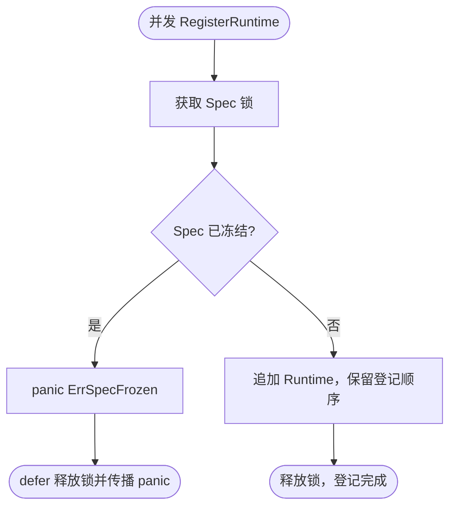

登记不调用 Runtime，也不启动后台工作；冻结后的写入直接 panic，不在此重复记录日志。冻结时在同一锁内复制 Runtime 列表，后续生命周期消费该快照。

Runtime 可以选择实现两个与服务注册相关的接口：`ServiceNamer` 汇报承载的业务服务名、无法推导服务名的业务入口和推导错误；`RegistrationExempt` 返回 true 时即使实现了 `Endpointer` 也不参与服务注册。`server.Runtime` 的业务 Server 实现前者，管理端口实现后者。

### 停机超时热更新

`NewStopPolicy` 以 `NewConfig` 已校验的 `app.stop_timeout` 为初值，并订阅该字段的后续更新；只校验该字段为合法且为正的 Duration，其他 app 字段不会阻止更新。运行时从源中省略字段遵循官方 merge，不保证恢复默认值。

更新在订阅通知时校验：合法且有变化时原子发布并记录 INFO `app.stop_policy.updated`（字段 stop_timeout、previous）；非正值或解码失败时保留原预算并记录 WARN `app.stop_policy.rejected`（字段 stop_timeout 为保留的预算、error）。首次请求停机时冻结所读预算，后续更新不影响本次停机。Wire cleanup 取消订阅，取消函数本身幂等。

建议 `app.stop_timeout` 大于 `server.stop_delay` 并预留资源清理时间，但不做跨组件硬校验；预算不足时可能在服务器等待或清理完成前耗尽。

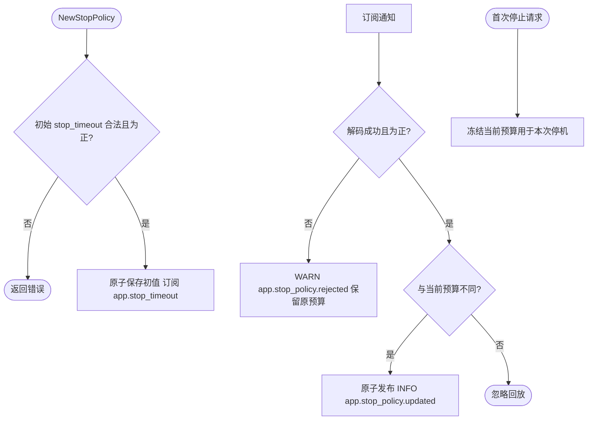

### App 的同步边界

停止请求、停止前钩子分别由 `stopOnce`、`beginStopOnce` 保证只执行一次；`stopping` 与 `ready` 为原子状态，Ready 探针不取锁。`mu` 只保护已注册实例、注销状态与故障列表，外部注册中心调用、钩子和 Runtime 调用均在锁外执行。每个实例注册成功后与并发停止通过“记录实例后读 stopping / 写 stopping 后读已注册实例”的顺序保证至少一方执行注销，已注销位置标记保证每个实例最多注销一次。

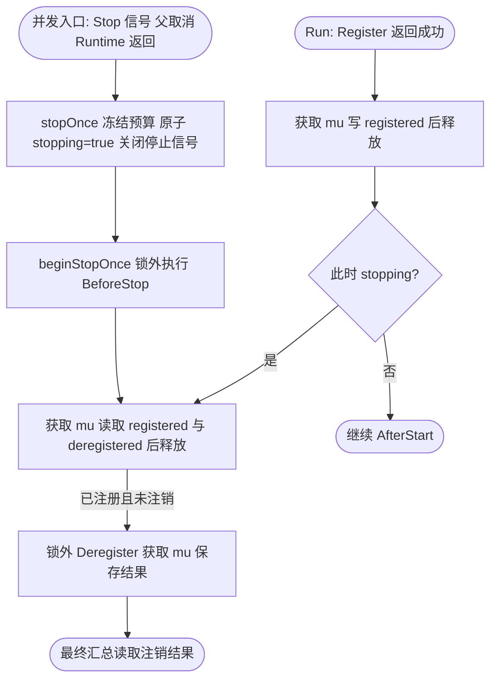

### 启动回调错误分类

在停止期间，启动钩子或注册回调可能同时返回取消与真实错误。只有错误树全部叶子都是 `context.Canceled` 时才归一化为正常停止；`errors.Join(context.Canceled, err)` 中的业务错误仍参与最终返回。本路径返回错误，不新增日志。

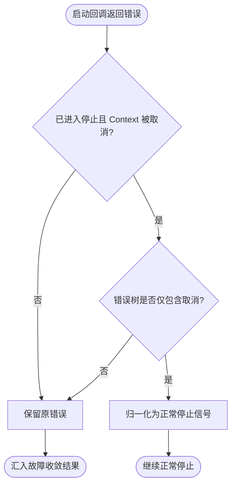

## 就绪状态与退出期限

`Spec.Ready()` 可并发读取：构造前、启动后钩子尚未全部完成或已经请求停机时为 false；全部 AfterStart hook
成功且未请求停机时为 true；收到停机请求立即为 false。ServerBootstrap 将它绑定到 `/readyz`，
不会等 stop_delay 或资源 cleanup 才撤销就绪。状态通过原子变量读取，不在探针路径获取生命周期锁。

`Spec.WaitReady(ctx)` 等待同一个单次 Ready 信号，供必须晚于启动后钩子的内部 Runtime 使用；启动后钩子全部成功后解除等待。App 会并发调用各 Runtime 的 `Start`，其正常实现通常阻塞到停止，因此 Ready 不代表每个 `Start` 已经返回成功，也不能提前确认任意自定义 Runtime 的异步初始化；内置业务 HTTP/gRPC 会在端点解析阶段提前建立监听，其他依赖应通过 Before/AfterStart hook 或 readiness check 表达。等待期间若调用方 Context 取消，返回该 Context 的错误；若应用请求停机，共享停止信号解除等待并返回 `context.Canceled`，不依赖 Runtime 的启动 Context 是否可取消。就绪和停机同时发生时优先识别停机；已经停机的应用即使曾经 Ready，新的 WaitReady 也返回取消。Ready 信号不是健康检查订阅，不会因后续依赖检查失败重新阻塞；业务请求通常应读取 `Ready()`。通过 `bootstrap.NewJobBootstrap` 登记的 Job Runtime 使用该信号，确保任务不会早于应用 Ready 执行。

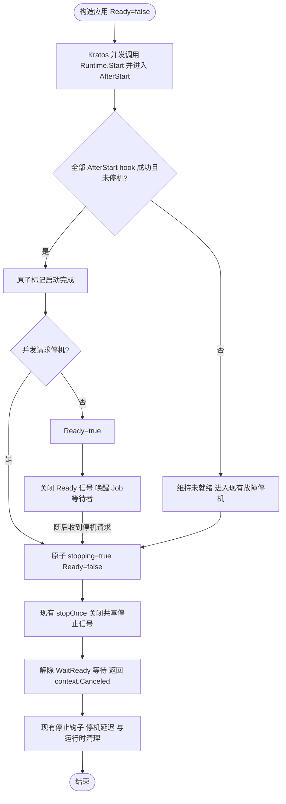

Context 是取消通知，不能强杀 goroutine。不响应它的依赖或业务代码可能使请求超时后继续执行、
后台任务迟迟不退出、Wire cleanup 阻塞，或者在资源关闭后继续访问资源。应修复实际调用链：传递
Context，使用支持取消的数据库/网络 API，为连接和读写配置超时，在循环中检查取消。对没有取消
能力的阻塞 SDK，应使用其受支持的关闭机制或进程隔离；不要通过额外 goroutine 超时返回来冒充
任务已经停止。AfterStop 与无参数 Wire cleanup 不能视为整个进程的硬退出期限。
最终进程期限由部署平台执行；强制终止可能打断未完成工作，因此业务需支持幂等与恢复。

## 驱动组装入口

应用通过 `spec.Configuration` 声明额外来源，由 `bootstrap.NewConfigManager` 构造默认包含官方 env source 的配置源链，使用 `registry.NewFactory` 管理具名注册与发现实例，由 `bootstrap.BaseProviderSet` 完成组装。注册与发现仅提供驱动入口。详见[驱动组装与迁移](../registry/README.md)。

## Runtime panic 防护

App 对 Runtime 的 `Start`、`Stop` 与 `AbortStartup` 统一恢复 panic：记录 ERROR `app.runtime.panicked`（字段 phase、panic_type，堆栈仅在 Debug 下输出），并把它转为真实故障走统一停机，仍执行 BeforeStop、服务注销和其余 Runtime 的 Stop，Run 返回 `runtime <phase> panicked with <type>`。错误与日志只带 panic 的类型而不带取值，避免泄漏请求或凭据内容。启动与停止钩子运行在 Run 所在 goroutine，panic 仍向调用方传播。

## 应用日志

`NewApp` 完成、`Run` 解析 Endpoint 和执行 BeforeStart 之前记录 INFO `app.assembled`。字段为 service.id/name/version、env、hostname、pid、executable、go_version、runtimes、service_registration，`msg=application assembled`；生命周期事件（assembled/ready/stopping/stopped/startup.aborted）均带固定 msg，便于在混合日志中直接阅读；env 优先使用最终 App metadata，否则读取 env.AppEnv，hostname 缺失时不推测。executable 只保留 argv[0] 的 basename，不展开 argv、任意 metadata 或配置内容。日志使用本应用登记的 Logger；输出级别和过滤仍由日志策略决定，不保证被过滤的字段可见。

启动后钩子全部成功才记录 INFO `app.ready`；首次请求停止记录 INFO `app.stopping` 和冻结 stop_timeout；全部运行时与停止钩子汇总后记录 `app.stopped`：成功或纯取消为 INFO，真实失败为 ERROR，字段 result/error。事件自身表达操作，不额外拼写重复正文。构造依赖校验失败尚未形成 App 时返回给组装入口处理，不伪造 assembled/ready。应用级终态摘要可与特定 Worker 或任务错误并存，但 Runtime 包装层不重复记录原错误。

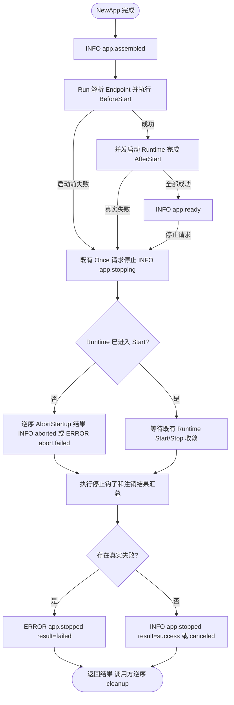
