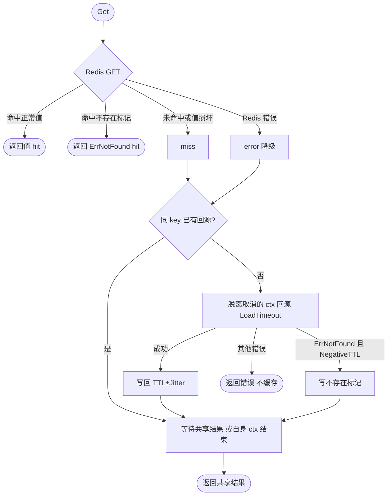

# cache

## 定位

基于 Redis 的旁路缓存（cache-aside）：`Get` 先读缓存，未命中时调用业务回源函数并写回。它解决三个常见问题：

- **击穿**：同一进程内同一 key 的并发未命中只回源一次（`singleflight`），结果共享给所有等待者。
- **雪崩**：写入时 TTL 在 `TTL×[1-Jitter, 1+Jitter]` 内随机取值（默认 ±10%），同一批 key 不会同时过期。
- **穿透**：回源返回 `cache.ErrNotFound` 且配置了 `NegativeTTL` 时缓存“不存在”，不存在的 key 不再反复打到数据源。

缓存只借用 Redis 连接（`*goredis.Client`、`goredis.UniversalClient` 或实现 `cache.Client` 的替身），不负责关闭。不提供本地内存缓存、跨进程合并或写穿（write-through）。

## 用法

```go
client, _ := redisManager.Connection("cache")
productMetrics, _ := metrics.NewCacheMetrics(metricsProvider, "products")
products, err := cache.New[*Product](client, cache.Config{
    KeyPrefix:   "orders:product",
    TTL:         10 * time.Minute,
    NegativeTTL: 30 * time.Second,
}, cache.WithMetrics[*Product](productMetrics))

product, err := products.Get(ctx, id, func(ctx context.Context) (*Product, error) {
    product, err := repo.FindProduct(ctx, id)
    if errors.Is(err, gorm.ErrRecordNotFound) {
        return nil, cache.ErrNotFound
    }
    return product, err
})

// 写库提交后失效旧值。
_ = products.Delete(ctx, id)
```

| 字段 | 默认 | 说明 |
| --- | --- | --- |
| `KeyPrefix` | 必填 | Redis key 为 `<KeyPrefix>:<key>`；不同缓存使用不同前缀，多个应用共享 Redis 时带上应用名 |
| `TTL` | 必填 | 缓存值基础过期时间 |
| `Jitter` | 0.1 | TTL 随机浮动比例，范围 0–0.5，负值关闭 |
| `NegativeTTL` | 0 | 大于 0 时缓存 `ErrNotFound`；应明显短于 TTL，数据新增后最多在该时长内仍返回不存在 |
| `LoadTimeout` | 10s | 单次回源超时 |

值默认用 JSON 编码，`WithCodec` 可替换；Redis 中的值首字节为格式标记（1 正常值、0 不存在），不要与其他写入方共享同一前缀。

## 失败语义

- **Redis 读失败**（断连、超时）：记 `business_cache_lookups_total{result="error"}`，降级为直接回源并返回结果；调用方 ctx 已结束时直接返回 ctx 错误。
- **缓存值损坏或格式不识别**：按未命中处理，回源后覆盖。
- **回源失败**：错误原样返回，不写缓存；`ErrNotFound` 只在配置 `NegativeTTL` 时缓存。
- **Redis 写失败**：忽略，不影响返回值，下次请求重新回源。
- **取消**：回源在脱离调用方取消的 Context 中运行（保留 trace 等值，受 `LoadTimeout` 约束），第一个调用方取消不会让合并等待的其他调用方一起失败；每个调用方仍按自己的 ctx 提前返回。回源函数仍须响应传入的 ctx。

## 一致性边界

`Delete` 只删除当前值。删除与并发回源存在竞态：回源读到旧数据后、写回前发生的删除会被旧值覆盖，最长保持一个 TTL。对一致性要求高的数据应缩短 TTL，或在写库提交后延迟再删一次；需要强一致的读不要走缓存。

## 指标

`WithMetrics` 复用 [`metrics.CacheMetrics`](../metrics/README.md)：命中、未命中、访问错误按 `business_cache_lookups_total{cache_name,result}` 统计；实际回源只由执行回源的一方记录一次 `business_cache_loads_total` 与 `business_cache_load_duration_seconds`，合并等待的调用方不重复计数，`ErrNotFound` 记为成功回源。应用组件面板的缓存分区直接使用这些指标。



## 验证

`go test ./pkg/cache` 用进程内替身覆盖命中、合并、取消隔离、空值缓存、降级与损坏值；设置 `FOUNDATION_TEST_REDIS_ADDR` 后 `TestExternalCacheRedis` 在真实 Redis 上验证编码往返、TTL 与删除，根 `make test-external` 也会执行。
