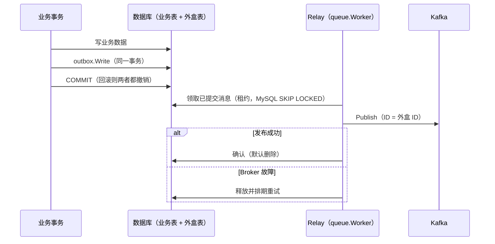

# outbox

## 定位

Kafka 事务外盒（transactional outbox）：业务在**同一个数据库事务**里写业务数据和待发消息，事务提交后由 Relay 把消息发布到 Kafka。它消除“业务提交了但消息没发出去”和“消息发出去了但业务回滚了”两类不一致：

- 事务提交 → 消息最终发布（Broker 故障时按重试策略重发）。
- 事务回滚 → 消息随之撤销，从不发布。

待发消息存放在支持事务投递的 `queue.Store` 中，通常是 [数据库 Queue](../../../contrib/queue/database/README.md)（`contrib/queue/database/gorm` 的 SimpleRepo 即可）；Relay 就是一个 `queue.Worker`，直接复用队列的租约、重试、失败归档、MySQL `SKIP LOCKED` 领取、存储故障退避与可选续租。本包不拥有数据库连接或 Kafka 客户端。

## 用法

```go
// 组装：外盒表与业务表在同一个数据库，连接提供者必须是事务感知的 database.Manager。
repo, _ := queuegorm.NewSimpleRepo(ctx, databaseManager, queuegorm.SimpleConfig{Table: "kafka_outbox"})
box, _ := outbox.New("orders-outbox", databasequeue.NewStore(repo), queue.NewObservability(logger, tracing, metrics))

raw, cleanup, _ := kafka.NewProducer(kafkaFactory, kafka.ProducerConfig{Connection: "default", Topic: "orders.events"})
producer, _ := kafka.NewManagedProducer("orders.events", raw, kafka.Observability{Logger: logger, Tracing: tracing, Metrics: metrics})
relay, _ := box.Relay(outbox.RelayConfig{Producers: map[string]kafka.Producer{"orders": producer}})
spec.RegisterRuntime(relay)

// 业务：在事务内写外盒。
err := databaseManager.Transaction(ctx, func(ctx context.Context) error {
    if err := orderRepo.Create(ctx, order); err != nil {
        return err
    }
    _, err := box.Write(ctx, outbox.Message{
        ID:    "order-created:" + order.ID, // 稳定 ID，消费者据此去重
        Topic: "orders",                    // 对应 RelayConfig.Producers 的键
        Key:   []byte(order.ID),
        Body:  payload,
    })
    return err
})
```

`Message.Topic` 是 Relay 中 Producer 的选择键，不必等于 Kafka 真实 Topic；一个外盒可以服务多个 Topic。

## 语义与边界

- **至少一次**：发布成功后、确认前进程崩溃，消息会再次发布。Kafka 消息的 `ID` 等于外盒 ID，消费者必须按 ID 幂等。
- **重复写入**：使用稳定 ID 时，记录仍在外盒中（待发、失败，或 Repo 开启 `RetainCompleted`）期间再次 `Write` 返回 `queue.ErrDuplicate`，整个业务事务应随之回滚或改为忽略；默认发布成功后删除记录，同一 ID 之后可以再次写入。
- **重试**：`RelayConfig.Worker` 未设置 `MaxAttempts` / `Retry` 时默认 100 次、1s 起倍增、上限 1min，约覆盖 1.5 小时的 Broker 故障；耗尽后进入失败归档，用队列运维接口（`Queue.Operations` / Store `Failed`/`Retry`）查看和重放。`Message.Topic` 没有对应 Producer 时直接失败归档（reason=permanent），不重试。
- **顺序**：`Concurrency` 默认 1，大致按写入顺序发布；失败重试的消息会排到后续消息之后，多实例 Relay 之间也不保证顺序。需要按 Key 严格有序时不要依赖 Relay 顺序，由消费者按版本号或时间戳处理乱序。
- **时延**：消息在事务提交后、下一次轮询（默认 200ms）内被领取；空闲时每个 Relay 每轮询间隔查询一次外盒表。
- **追踪**：`Write` 把当前 trace 上下文保存在外盒任务中，Relay 执行时恢复，经 `ManagedProducer` 注入 Kafka Header，消费端可串联到写入时的请求。
- **表与清理**：外盒表按 [数据库 Queue](../../../contrib/queue/database/README.md) 的模型迁移；默认成功即删除，失败记录需要监控（`FoundationQueueRuntimeFailure`、失败任务数）和定期处理。



## 验证

`go test ./pkg/kafka/outbox` 在 SQLite 上覆盖提交发布、回滚不发布、重复 ID、Broker 故障重试与未知 Topic 归档；设置 `FOUNDATION_TEST_QUEUE_MYSQL_DSN` 与 `FOUNDATION_TEST_KAFKA_ADDR` 后 `TestExternalOutboxKafka` 在真实 MySQL 与 Kafka 上验证事务写入到消费的全链路，根 `make test-external` 也会执行。
