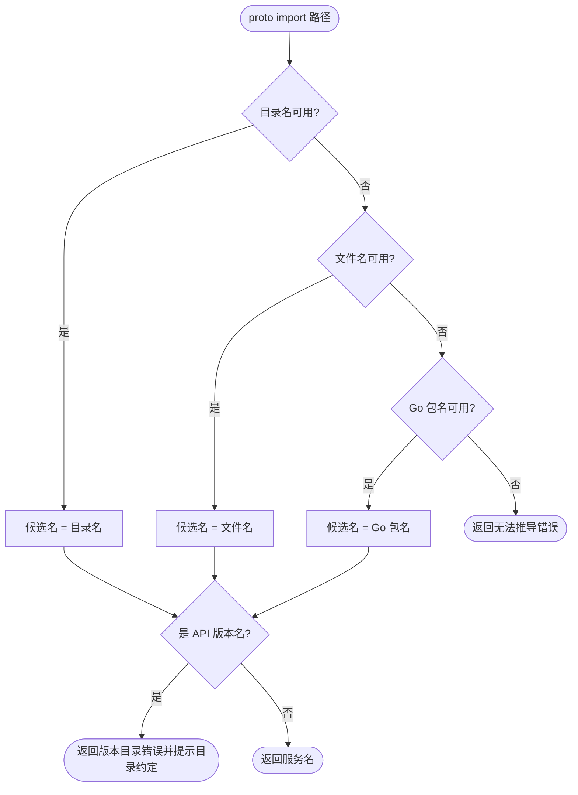

# servicename

`servicename` 定义 proto service 到逻辑服务名的唯一推导规则。客户端插件生成默认连接名、服务端注册到注册中心、网关推导后端服务时都调用它，所以三处得到的名字总是一致的。

```go
name, err := servicename.Of(walletpb.File_wallet_service_wallet_service_proto.Services().Get(0))
// name == "wallet_service"
```

服务名只由 proto 文件路径决定，没有声明式覆盖：

1. proto 文件所在目录名，例如 `wallet_service/wallet_service.proto`、`wallet_service/wallet_inner_service.proto` 都得到 `wallet_service`；
2. 顶层 proto 文件使用文件名（不含扩展名）；
3. 以上都不可用时使用 Go 包名。

目录约定是 `api/<service_name>/*.proto`，想换服务名就换目录。推导结果是 `v1`、`v2beta1`、`v1alpha`、`v1p1beta1` 这类 API 版本名时返回错误，因为版本目录名无法区分服务；`v2ray` 这类只是以版本开头的普通名字不受影响。

`Of` 读取运行期描述符；`FromPath(protoPath, goPackageName)` 是生成期与运行期共用的底层入口，`protoPath` 是 protoc 看到的 import 路径。描述符来自生成代码还是运行时编译的 proto，结果都相同。

`IsFramework` 报告 gRPC 健康检查、反射、channelz 等标准服务，以及每个 Kratos gRPC Server 自动注册的 `kratos.api.Metadata`。这类服务由框架自动注册，不属于任何业务服务名，服务名收集时应先排除。

包不持有资源，也没有 cleanup。


