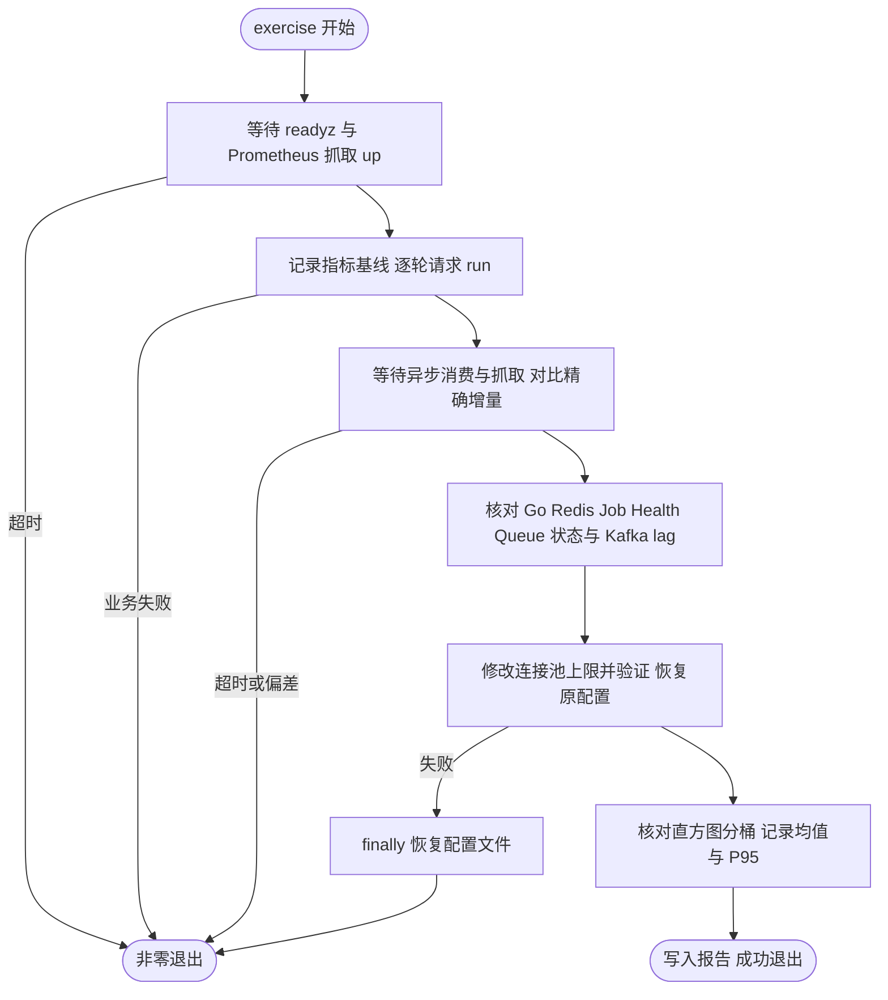

# 组件指标实测

在本地 Docker 中运行 [components 示例](../../examples/components/README.md)，驱动真实业务并核对各组件指标的**精确增量**。用于验证组件指标、面板查询与告警规则在真实数据下的表现。

## 运行

在仓库根目录执行，需要 Docker Compose v2 与 Python 3（镜像内已包含编译环境）：

```sh
make components-up        # 合并 test/observability 与本目录 compose，启动 components-api、Redis、Kafka、Kafka exporter、OSS 模拟服务
make components-exercise  # 默认 5 轮、间隔 5 秒；python3 test/components/exercise.py --rounds 10 指定轮数
make observability-down   # 停止并移除容器，保留 Prometheus/Grafana 数据卷
```

- Grafana：<http://127.0.0.1:13000>，Prometheus：<http://127.0.0.1:19090>
- 业务入口：`POST http://127.0.0.1:18010/demo/run`，每次生成独立 run ID
- 指标与健康：`http://127.0.0.1:19011/metrics`、`/healthz`、`/readyz`
- 报告：`test/components/.runtime/latest-report.json`（含预期/实际增量与延迟分位数；失败时非零退出）

`components-up` 每次把 `examples/components/configs/config.yaml` 复制到 `.runtime/config.yaml`。不要同时运行多个 exercise 或手动投递，额外流量会改变增量。OSS 使用真实阿里云 SDK 访问本地协议模拟服务，不是云端端到端验证；`python3 test/components/oss-emulator.py --self-test` 可单独自检模拟服务。

## 每轮预期

| 组件 | 操作 | 每轮可核验结果 |
| --- | --- | --- |
| HTTP Server / Client | Run、Catalog、Inventory；Client 调 Hello、Catalog、Inventory | Server 和 Client 各三个 operation 的 200 各 +1 |
| Database | 创建订单、事务读与更新、缓存回源、删除、确认不存在 | create +1、query success +2、update +1、delete +1、query not_found +1、递归汇总 raw +1 |
| Redis / 业务 Cache | 首次 GET 未命中，回源并 SET，再读三次，结束 DEL | hit +3、miss +1、load success +1 |
| Lock | 获取、同键竞争、TTL、续租、释放 | 五种操作各 +1，竞争为 contended |
| OSS | 上传、Stat、Exists、完整下载校验、删除 | 五种请求各 +1；上传/下载各 44 字节 |
| Kafka | 成功、首次失败后重试成功、永久失败进入死信 | 生产 +3；消费 success +2 / dead_lettered +1；retry +1；死信生产 +1；处理完成后 lag=0 |
| Queue | 成功、重试成功、永久失败归档 | 生产 +3；success +2、retry +1、failed +1；失败归档 +1 |
| Queue 积压 | 无 Worker 队列放入立即与 24 小时后任务 | ready +1、scheduled +1；最老 ready 年龄随时间增长 |
| Job | 每 10 秒 Redis Ping、DBSIZE、TTL | 三个任务 success 持续增加，不按轮次断言 |
| Config | 运行副本 `max_open_conns` 8 → 9 → 8 | 连接池最大值随之变化并恢复 |
| Health / Go | blackbox 探测与默认采集 | healthz/readyz=1，Redis 为就绪依赖 |

SQL 慢查询阈值配置为 `0.010s`，每轮递归汇总 UPDATE 至少触发一次慢操作；机器过快导致低于阈值时会核验失败，不伪造耗时。Redis 命令数包含队列轮询、Job 和健康探测，`redis.Nil` 被 SDK 计为 error，不能等同业务 GET 次数或错误率。


